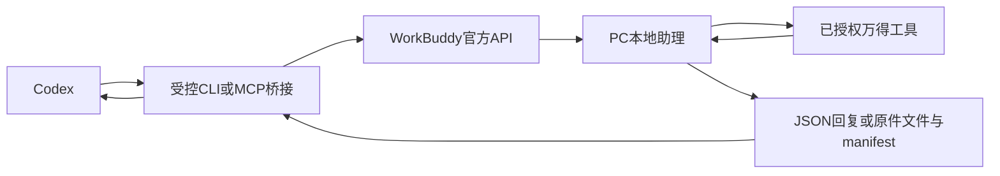

# Codex 调用 WorkBuddy／万得并回传结果：方案调研

整理日期：2026-10-10（北京时间）；引用前一日只读探测回执。范围：官方文档核查、现有只读探测回执和接入方案设计；本轮没有注册应用、配置授权、创建自动化、发送任务或查询万得。保护已有文件，不接触实际研究分片／SEALED或训练额度。

## 结论

有官方支持的程序化路径：**Codex → 自建小型桥接程序 → WorkBuddy Open API → PC本地助理 → 已授权万得能力 → 回复／导出文件 → Codex核验**。发送和增量取回复都有公开接口；万得能否在该助理入口调用、是否能导出原体以及历史版本能力，必须实际验证。接口文档成立不等于本机权限已经成立。[WorkBuddy Open API](https://open.workbuddy.cn/docs/openapi)

另一条条件性更短的路线是把万得MCP直接接给Codex，但必须先取得供应方支持的服务地址／启动方式及独立客户端授权。WorkBuddy支持外部MCP，Codex也支持STDIO、Streamable HTTP和OAuth；这只能证明客户端协议兼容，不能证明万得当前套餐允许迁移或复用授权。[WorkBuddy MCP](https://www.codebuddy.cn/docs/workbuddy/From-Beginner-to-Expert-Guide/Function-Description/MCP-Guide)、[Codex MCP](https://learn.chatgpt.com/docs/extend/mcp?surface=cli)

这里的“万得数据库”先理解为WorkBuddy中已授权的金融数据能力，其具体载体可能是连接器、MCP、Skill或Buddy应用。取回专业数据需要走对应工具与许可；WorkBuddy的桌面登录态不是一个对所有外部程序开放的数据库账号。

## 已确认与尚未确认

| 项目 | 结论／依据 |
| --- | --- |
| PC任务派发 | 官方有本地助理消息API，返回message_id；不是只有云端任务API |
| 回复回传 | 官方有消息增量GET，返回内容数组、附件和metadata |
| 本地独立任务终态 | 公开schema未定义job_id、reply_to或任务终态；需桥接层约定完成标记 |
| 本地助理调用本机能力 | 官方远程助理说明使用本机环境和插件；万得具体连接器可用性仍待实测 |
| 调用权限 | 需要合法第三方应用及OAuth授予的localassistant scopes；普通账号登录不自动满足 |
| 当前环境 | 既有匿名GET返回401；未取得授权，不代表Wind查询失败。原回执为workbuddy-openapi-probe.json |
| 万得MCP直连 | 两端支持MCP；未取得用户当前万得服务的可移植配置／许可，不宣称已经可直连 |
| 云任务继承桌面万得 | 所读官方文档没有承诺，不能假定 |
| 历史PIT | 无论哪种取数链路，都必须另查版本、公开时点和修订证据；今天查到的旧行不自动满足 |

API事实见[官方本地／云端接口](https://open.workbuddy.cn/docs/openapi)与[第三方应用要求](https://open.workbuddy.cn/docs/third-party-app)；本机助理边界见[官方企微助理说明](https://www.codebuddy.cn/docs/workbuddy/Wecom-Guide)。详细字段核查另存于[workbuddy-api-research.md](workbuddy-api-research.md)。

## 路线比较

| 路线 | Codex怎样发起 | 怎样取结果 | 前提 | 判断 |
| --- | --- | --- | --- | --- |
| A. 官方PC助理API＋桥接 | 桥接调用POST消息接口 | GET增量回复＋工作目录中完成manifest／附件 | 已启用第三方应用、本地助理读／调用scope、PC在线、万得在该入口可用 | 最贴近已有桌面授权，优先验证 |
| B. 万得MCP／官方API直连 | Codex直接调用数据工具 | 工具原始结构化返回＋归档 | 供应方提供可用于Codex的服务和独立授权 | 若许可成立，数据链最短；目前未确认 |
| C. WorkBuddy自动化＋共享目录 | Codex写请求文件，WorkBuddy定时任务扫描 | WorkBuddy写输出／完成manifest，Codex轮询文件 | 用户一次配置WorkBuddy工作目录、连接器和定时任务 | 缺少开放平台应用时可用的设计备选，有延迟和Agent调用成本 |
| D. Windows桌面控制 | 输入测试提示词并提交 | 从产物区导出文件 | 执行环境确实提供原生桌面控制 | 可以作为操作层备选，当前会话没有该表面，批量不优先 |
| E. 云任务API／ACP | 创建云任务并发送prompt | ACP终态／云产物接口 | 云环境另有万得连接器／授权 | 云API本身可用，但没有桌面万得继承保证 |

A/E的接口依据见[Open API](https://open.workbuddy.cn/docs/openapi)；C的定时、工作目录和连接器能力见[官方自动化说明](https://www.codebuddy.cn/docs/workbuddy/From-Beginner-to-Expert-Guide/Function-Description/Automation-Guide)。A/C的manifest、请求文件和串行控制是本文提出的桥接设计，不是现成WorkBuddy功能。

## A：官方PC助理API如何形成闭环

官方主机为`https://www.workbuddy.cn`：

| 请求 | 所需scope | 作用 |
| --- | --- | --- |
| GET `/openapi/v2/localassistant` | `user.localassistant.readable` | 检查data.online |
| POST `/openapi/v2/localassistant/message` | `user.localassistant.invokable` | 发content字符串与msg_type=text；取得data.message_id |
| GET `/openapi/v2/localassistant/message?message_id=<ID>` | `user.localassistant.readable` | 取该消息之后的新消息 |

OAuth的公开完整流程是第三方应用登记／审核启用、用户授权、授权码换token及刷新。client_secret应留在受信任服务端，不放进提示词、源码仓库或结果文件；桥接可以由本地CLI／MCP调用，但密钥端不能直接变成可分发客户端。实际配置细节应以批准的应用类型和回调为准。错误码提到device授权不代表完整Device Flow已公开，不能猜端点。[授权与API](https://open.workbuddy.cn/docs/openapi)、[应用登记](https://open.workbuddy.cn/docs/third-party-app)

重要限制：message_id只用于增量读取，不是独立job句柄。发送成功不代表查询完成；后续消息也未必全部属于此次请求。[公开消息schema](https://open.workbuddy.cn/docs/openapi)

因此建议增加下列小型桥接约定：

1. 每次请求生成request_id和request_sha256，包含证券、限定日期、字段、原件要求和输出目录；只串行处理一个在途任务。
2. 将这些字段和提示词发给本地助理，不自动回答权限弹窗；状态为等待授权时明确返回WAITING_PERMISSION。
3. 轮询消息时去重并推进游标，保存必要请求／响应日志；只接受回显request_id和request_sha256的结果。用户在同一助理会话插入其他请求时检测交错，不把其他回复归入本次数据。
4. 小结果可回传完整JSON；较大结果要求输出文件，再原子写完成manifest，列出路径、长度、SHA256和实际错误。平台附件字段不自动保证完整原体可下载，需要实测。
5. Codex等待manifest，检查ID、实际文件、长度、哈希、记录数、单位和来源；超时、半成品或不匹配均保留失败，避免重复提交造成重复取数。
6. 清晰区分任务成功、数据齐全、来源合格和ticket19验收。工具返回行情只完成第一层数据获取。

建议给Codex的最小桥接工具是`check_status`、`submit_query`、`get_result`，具体名称是设计建议。submit_query会创建外部Agent工作，不能标成纯只读状态查询。WorkBuddy REST接口不是MCP服务器，不能直接把上述REST URL填进MCP配置；需要自己实现适配或用受控CLI调用。

## B：万得直连应先确认什么

需要拿到万得能力的准确名称和提供方支持的接入方式，而不是复制WorkBuddy内部认证缓存。核对服务传输、工具列表、账号是否允许别的客户端、字段权限、历史版本接口和导出范围。独立OAuth授权应由相应服务完成。

Codex官方支持HTTP／STDIO与OAuth，WorkBuddy连接器可以由MCP或CLI方案实现；因此具有可移植服务的情况下可复用协议，属于条件性技术可行。未获得实际服务地址、工具schema和授权时，不能给出假想的wind MCP URL或断言当前免费／订阅权益覆盖外部调用。[Codex接入能力](https://learn.chatgpt.com/docs/extend/mcp?surface=cli)、[WorkBuddy连接器形式](https://open.workbuddy.cn/docs/connector)

CodeBuddy Code CLI是另一产品入口；即使安装，也没有从现有证据证明它自动继承WorkBuddy桌面万得连接器。安装包内网页／Buddy应用SDK也不独自证明存在免授权的外部桌面调用接口。此处不采用认证提取、内部数据库读取或未文档化端口作为稳定集成。

## C：共享目录是实际可考虑的退路

官方自动化支持定时执行、指定工作目录及连接器，并沿用执行用户身份；官方项目说明当前触发形态是定时。这里不假定支持文件事件即时触发。[自动化](https://www.codebuddy.cn/docs/workbuddy/From-Beginner-to-Expert-Guide/Function-Description/Automation-Guide)、[项目触发说明](https://www.codebuddy.cn/docs/workbuddy/From-Beginner-to-Expert-Guide/Function-Description/Project)

可设计一个独立目录，例如`.scratch/workbuddy-bridge/`中的inbox、processing、outbox；Codex写job JSON，WorkBuddy预配置定时任务读取一次、调用万得并写输出。请求ID、日期白名单、去重、异常和完成manifest必须具备；只授权这个目录。不要让WorkBuddy获得Roll运行数据库或SEALED目录。此方案尚未创建或验证；它绕开Open API开发者应用需求，但依赖WorkBuddy任务运行和调度，效率需小测试衡量。

## 最小验证顺序

1. 先确认用户目前“万得金融数据”是何种连接器／Buddy应用，以及本地助理任务是否可选用它；只需能力名称和非敏感说明，不收集认证材料。
2. 若已有可用官方第三方应用，走A；若万得提供独立MCP／API，验证B；若两者都没有，以C做一次低频测试，不建设大系统。
3. 查询`600362.SH`在`2020-06-01..2020-06-05`的RAW开高低收／成交量，最多一个行情请求和一个字段／历史版本说明请求，使用现有[小测试提示词](workbuddy-wind-smoke-test.md)。
4. 测试成功必须看到实际工具调用与实际结果文件／原体、明确单位、真实接收时间、错误码和版本能力。连接成功、消息创建或模型口头说查到了，均不够。
5. 只有小测试的来源与时点能力核验后，再扩大取数。若Wind只支持当前修订历史行，先记CURRENT_QUERY_ONLY；这仍不能解除ticket19的PIT、完整状态／权益和真实训练路径缺口。

目前最具体缺口是**可用授权与本地助理下万得工具实测**。研究已证明有官方程序接口，不再把问题表述为“完全不能控制WorkBuddy”；同时尚未建立认证和运行闭环，不能声称现在已能调用其万得数据。
