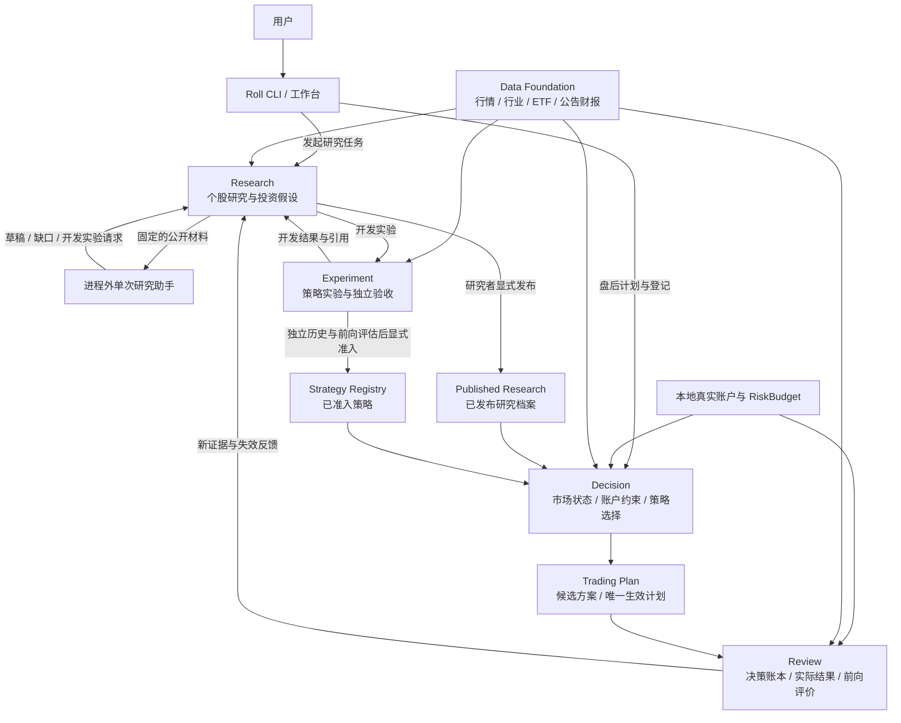

# ROLL 投资研究与决策辅助系统：需求与架构设计

> 文档版本 v1.2（Roll 研究编排与 M1 开发顺序）
>
> 文档性质：产品需求、领域架构及工程验收约定  
> 适用范围：面向 A 股个人投资者的投资研究与决策辅助系统

## 1. 项目背景

个人投资者在分析一只股票时，通常需要同时理解市场环境、行业轮动、ETF 资金配置、个股量价关系、公司基本面和自身账户风险，并据此选择持有、趋势跟随、波段交易、网格交易或退出等不同方案。

现有分析方式的主要问题并非缺少指标，而是缺少一套从研究证据到交易决策、再从交易结果反向验证研究判断的完整闭环：

- 大盘、行业与个股之间的相关关系，容易被误认为具有未来收益预测能力。
- 短期历史数据及大量策略回测容易产生过拟合，历史最优策略未必适用于未来。
- 财报、ETF 份额及行业数据存在披露时间、修订版本、缺失与统计口径等问题，可能直接破坏研究和回测结果。
- 定性研究与定量策略容易脱节，研究报告无法直接被决策系统消费。
- 多个交易策略可能产生相互冲突的信号，账户风险无法得到一致管理。
- 每日或盘中反复修改交易方案，容易将研究系统变成事后解释行情的工具。

ROLL 的目标是建立一个**证据驱动、可验证、可追溯的个人投资研究工作台（Evidence-driven Investment Research Workbench）**，而非一个依赖历史参数优化或大语言模型主观预测股价的自动交易机器人。

## 2. 项目目标与范围

### 2.1 核心目标

1. 围绕持仓及关注股票，建立持续维护的个股研究档案，理解大盘、行业、ETF 资金、个股交易行为和基本面之间的关系。
2. 将投资观点转化为可观察、可证伪、在条件允许时可回测的投资假设，识别不同数据和研究方法的实际增量价值。
3. 建立独立的策略实验与准入机制，比较多个候选交易方案，避免将历史拟合结果直接转化为生产交易策略。
4. 根据当前市场状态、投资逻辑、已验证策略和个人账户风险，生成明确、可执行的下一交易日计划。
5. 支持按需盘后复盘、每周研究更新及盘中预定义风险监控；通过历史决策记录与前向验证持续评价研究质量。
6. 在数据和统计证据充分后，提供具有明确时间范围、事件定义、样本依据及不确定性的条件收益分布与概率预测。

### 2.2 首要使用场景

系统优先服务已有持仓和关注股票，而不是从全市场自动挖掘股票。典型使用流程为：用户选择股票，进行一次深入研究；系统形成研究档案、候选策略及实验结果；用户在交易日收盘后按需复盘，获得下一交易日计划；每周更新研究证据；在原有假设被证伪或出现重大变化时重新研究。

用户保留最终交易决定权，系统提供决策依据和风险约束，不代替用户自动下单。

### 2.3 非目标

第一阶段不建设以下能力：

- 自动实盘交易、券商自动下单及高频交易系统。
- 单只股票的高维机器学习概率模型，以及分钟级盘中预测模型。
- 无限制的 AI 自动假设探索、回测调参及生产策略自动发布。
- 全市场选股平台、全量宏观数据库、全行业产业数据库及复杂组合优化平台。
- 为覆盖所有边缘场景而提前设计多 Agent、微服务、复杂工作流引擎或可插拔框架。

系统不承诺每次预测正确，不承诺必然获得超额收益。策略有效性必须由独立实验及未来真实运行结果证明。

## 3. 核心架构原则与设计裁决

| 原则 | 设计要求 |
| --- | --- |
| 研究与决策分离 | 研究负责发现、解释和验证规律；决策仅消费已发布的研究结论与获准策略，不在每日决策时重新搜索最优策略。 |
| 证据优先 | 每个重要判断具备来源、时间、依据及失效条件；证据不足必须允许输出未知。 |
| 研究与生产权限隔离 | 探索结果不能直接进入生产；策略代码、参数、适用条件和评价标准必须经过冻结及独立验收。 |
| 账户与预测分离 | 账户盈亏、成本及资金需求影响仓位和交易行为，不改变客观统计模型对未来收益的估计。 |
| 时点一致性 | 历史研究与决策仅能使用当时已经可获得的信息；事后修订不得静默改写过去的决策。 |
| 特征级可用性 | 局部数据缺失只限制依赖该数据的研究和策略；不可伪造缺失数据，也不因非关键缺数阻断全部流程。 |
| 多方案、唯一生效 | 同一股票可有多个候选交易方案，但同一时刻只允许一个主动策略生效，账户风险统一管理。 |
| 简单优先、纵向交付 | 优先贯通一只股票的完整业务闭环，再根据实验价值扩展数据、策略和模型。 |
| 人机协作 | AI 辅助收集证据、分析及提出假设；确定性程序负责计算、验证、准入和风控；人负责最终交易决策。 |

## 4. 系统总体架构

系统由共享的数据基础层和四个领域模块构成。逻辑模块划分不要求独立服务，第一版采用模块化单体即可。

### 4.1 Research Pipeline（研究流水线）

**数据获取与证据收集 → 个股量化及基本面研究 → 投资假设 → 策略实验 → 研究档案与获准策略发布。**

研究流水线允许探索不确定性，研究周期由任务、证据变化及实验需要决定。研究中可以存在多个互相竞争的假设，也允许最终得出没有可靠交易优势的结论。

研究流水线负责产生可复用的研究成果，不负责为真实账户决定仓位或直接触发买卖。

### 4.2 Decision Pipeline（决策流水线）

**确定当前数据时点 → 读取已发布研究及策略 → 识别市场、行业和个股状态 → 应用账户及风险约束 → 比较候选方案 → 生成生效交易计划 → 记录与复盘。**

决策流水线在交易日收盘后按需运行，使用固定版本的决策规则和策略。盘中仅执行预定义条件检查、风险预警及计划暂停，不重新训练模型、优化策略或生成新的主动交易方案。

### 4.3 两条流水线之间的契约

- 研究流水线通过 `Research Dossier` 和 `Strategy Registry` 向决策流水线发布版本化成果。
- 决策流水线只能读取已发布、有效且适用于当前状态的成果，不直接消费 AI 的自由文本观点或未准入的实验结果。
- 复盘发现的数据问题、预测偏差或假设失效，可以产生新的研究任务；不能自动覆盖生产策略。
- 新研究结论和策略版本必须经过相应的发布流程，并从明确的生效时间开始影响未来决策。
- 每一份交易计划必须能够追溯到对应的数据快照、研究版本、策略版本和账户快照。

两条流水线可以共享数据和计算基础设施，但不能共享未经约束的策略修改权限。

### 4.4 本地 CLI 与外部研究助手

用户在 Roll CLI 或工作台提交标的和问题，Roll 拥有研究任务、尝试、快照、草稿及发布版本。M1 通过同一入口准备公开材料，按需调用进程外研究助手执行一次。对于预先选定的 E0/E1 对照，Roll 先计算开发期回执，再由助手根据实测结果撰写解读，随任务审阅归档。助手提出的其他实验可作为后续研究线索。当期个股档案草稿经人工审阅，通过 `roll research publish` 按版本显式发布。输入清单按任务用途固定截止时点、行情快照及所需公开证据。同输入重试产生新尝试，补入改变判断依据的材料后发起关联的新任务。[编排决定](../../adr/0006-roll-orchestrates-research-and-decisions.md)

盘后 `roll plan` 根据冻结输入和 §9.3 的规则生成唯一生效方案，`roll review register` 登记当天的正式及影子方案。盘后裁决全程零模型调用，账户快照、成交与资金预算留在本地。快照齐备时可断网运行确定性实验、生成计划并重放。相同决策输入下，新增或修改未发布草稿，计划应逐字段一致。

## 5. 数据基础层需求

### 5.1 数据建设范围及优先级

数据建设采用按研究对象和实验需求逐步扩展的方式，不提前追求全量覆盖。

| 优先级 | 数据 | 初期覆盖范围 | 主要用途 |
| --- | --- | --- | --- |
| P0 | 个股原始日线、成交量、成交额、复权因子、交易状态 | 持仓及关注股票 | 趋势、波动、收益、撮合回测 |
| P0 | 大盘与宽基指数日线、成交额等 | 固定核心指数集合 | 市场环境、因子暴露、基准 |
| P0 | 行业指数及必要的历史行业归属 | 研究标的所属行业 | 行业归因、相对强弱 |
| P0 | 公司公告、财报、业绩预告、业绩快报 | 按研究对象获取 | 基本面证据、投资逻辑约束 |
| P0 | 账户资产、现金、持仓、可卖数量、交易记录、风险偏好 | 用户账户 | 计划生成与账户级风险 |
| P1 | 宽基 ETF 份额、净值、成交额、基金规模、跟踪指数 | 核心 ETF 集合 | 资金配置与资金流研究 |
| P1 | 行业 ETF 数据、研报及盈利预测修正（有可靠来源时） | 按研究对象获取 | 行业资金及预期差研究 |
| P2 | 产业经营指标、宏观专题指标 | 按研究假设获取 | 个股基本面深入研究 |
| P2 | 跨标的历史数据及必要的历史股票池、成分与财务信息 | 概率研究阶段建设 | 跨标的统计及验证 |
| P2 | 分钟或更细粒度行情 | 经明确策略需求及可行性评估后接入 | 真实盘中网格或细粒度撮合 |

宽基研究集合建议覆盖上证50、沪深300、中证500、中证1000、中证2000、科创50、创业板指、中证A500等代表性指数；具体指数及 ETF 范围以研究价值、历史覆盖和数据可用性确定。行业划分应采用明确且一致的分类体系。

### 5.2 统一时间语义与数据可追溯性

每项用于历史研究或当前决策的数据，应能明确表示：业务日期或报告期、披露或可获得时间（`available_at`）、采集时间、来源、版本、统计口径及质量状态。对修订型数据保留原始披露及后续修订之间的关系。

历史时点查询遵守 `available_at <= as_of` 约束。数据的业务日期不等同于市场能够获知该数据的时间。若无法确定历史版本或公开时间，则不得将其作为具有 Point-in-Time 可信度的历史回测输入。

数据层需要支持不可变的决策快照标识或等效的版本引用，使过去的研究实验和交易计划可追溯。允许修复历史数据，但必须显式生成新版本；不能无记录地改变已完成的实验或决策。

### 5.3 A 股特有的数据及交易约束

**财务与公告数据。** 区分业绩预告、业绩快报、正式财报、更正公告及追溯调整。不能按照报告期直接对齐股价，也不能简单使用最新财报覆盖历史版本。若较新财报无法验证，不得静默退回严重过期的旧财报并给出正常结论。无法恢复历史披露版本的基本面规则，只能用于当前研究和后续前向验证。

M0 的基本面档案保存实际采用的材料标题、发行人、公告标识或链接、披露时间（未知可空）、采集时间和结论所据段落。仅对影响结论且需复核的材料按需留存原件。M1 的 E4 再按事件确认历史首发与更正版本。M0 的价格趋势回测使用当时可用的量价输入，当前研究档案自发布起约束未来计划。

**行情与复权。** 保存原始价格及复权因子。收益及相对指标使用一致的、符合历史时点的复权口径；订单价格、网格档位、支撑位及回测撮合使用当时可成交的原始价格。分红、送转等公司行动需要按实际日期处理持仓数量与现金影响。禁止直接使用事后重新锚定的前复权绝对价格进行历史成交判断。

原始日线分别保存上一交易日实际收盘和当日交易所口径的参考昨收 `pre_close`。除息日涨跌停和复权核对使用当日参考昨收与适用规则。公司行动单列登记日、除权日、派息日、送转股上市流通日、每股实际派现及送转配股条款。以江西铜业 2025-07-22 为回归样本：07-21 登记，符合条件的股份每股派息 0.70 元（税前），除息参考扣减约 0.6965 元，前日原始收盘 24.40 元，当日参考昨收按报价精度为 23.70 元，原始开盘为 23.73 元。登记日收盘的合资格持仓批次决定权益数量，登记日后卖出原股仍保留已取得的权益。[发行人权益分派实施公告](https://www1.hkexnews.hk/listedco/listconews/sehk/2025/0714/2025071400944_c.pdf) · [原始价格对照](../research/roll_dual_pipeline_review.md)

**在途权益与净值。** 除权日（含）起，将已取得但尚未到账的现金红利按应收金额、尚未上市的送转股按应收股数乘同一时点的原始估值价计入净值。此时可用现金和可卖股数保持原值。派息日把应收现金转为现金，上市流通日把应收股数转入持仓批次，并按适用规则确定可卖数量。转入与冲销在同一结算中完成；同日除权到账仅入账一次。冻结净值按现金余额、已入账持仓市值和未结在途权益之和计算。计划预留只影响资金可分配额度。

**股息红利税口径。** M0 的历史策略、两个比较基准与前向影子账户统一按个人股息红利税前计算，仍按冻结规则计入佣金、交易税费及滑点。实验配置和收益报告标明“股息红利税前、含交易成本”。真实账户按券商实际入账金额和实际扣税流水分别记录，避免对净额重复扣税。

**交易可执行性。** 根据标的及日期适用的交易规则，处理 T+1、可卖数量、停牌、涨跌停、最小申报数量、手续费、税费、滑点及成交限制。不能假设涨跌停时必然成交，不能用收盘后才获得的信息假设当天收盘价已经成交。

### 5.4 ETF 资金流的数据语义

ETF 成交额、基金规模变化、份额变化和估算净申赎金额是不同概念，不得混用。

在份额口径连续、净值可靠且已处理份额折算等特殊事件时，可使用以下估算：

$$
\widehat{Flow}_t=(Shares_t-Shares_{t-1})\times NAV_t
$$

相对资金流可使用估算净申赎金额除以前期基金规模，反映相对配置强度。该估算不是投资者实际交易金额，也不能识别资金最终所有者或交易动机。

需要处理以下问题：

- 沪深不同来源的披露日期和可获得时间差异；按数据实际可获得时点用于决策。
- ETF 份额缺失、基金份额折算、规模过小、极端流量、不同 ETF 跟踪指数重叠。
- 同一指数多只 ETF 的资金流可以在一致口径下聚合；跨指数合并时须注意成分股重复暴露，不能直接视为某只股票的实际流入金额。
- ETF 净申购可能来自趋势配置、逆势配置、套利、对冲或其他资金行为，不预设净申购等于看多。

当周三、周四份额缺失，周五份额较周二增加时，只能确定区间累计份额变化，不能将变化全部归到周五或平均填补为每天净申购。可根据有效端点构造明确标注的区间指标，不能伪造逐日资金流。

### 5.5 数据质量与降级

对研究特征及策略依赖声明必要数据、所需时间范围、可接受的时效及覆盖要求。质量状态至少区分可用、缺失、过期、口径不明和存在异常。

- 个股行情或账户关键字段缺失时，阻断依赖这些字段的可执行交易计划。
- ETF 份额不完整时，仅禁用受影响的资金流特征和依赖该特征的策略；个股与行业行情分析仍可运行。
- 基本面存在无法核验的较新信息时标记为 `unknown`，不得默认放行。
- 回测报告必须展示实际样本覆盖、排除原因及缺失处理方式；比较实验使用一致的可比样本，或明确解释样本差异。

不要求所有数据源达到百分之百覆盖才能提供基础研究能力，但不允许系统通过填零、静默回退或隐式插值制造虚假证据。

## 6. Research Pipeline：投资研究需求

### 6.1 个股研究入口

用户能够对指定股票发起一次完整研究，并在后续复用已有档案。研究入口包含数据覆盖检查、量化研究、基本面专题研究、投资假设生成、实验任务及研究结论发布。

同一股票的研究档案应支持按周刷新和重大事件更新；更新优先识别新证据及原有判断的变化，不要求每次重新进行全部历史回测。

### 6.2 多周期量价研究

默认分析窗口为近 5、10、20、60、120 个交易日，分别对应短期至中期观察；可增加 250 日作为年度历史基准。自然月统计如有需要，应与交易日窗口明确区分。

研究内容包括：

| 研究维度 | 核心输出 |
| --- | --- |
| 个股量价 | 多周期收益、成交量及换手变化、波动率、历史回撤、趋势和区间特征 |
| 大盘关系 | 相对收益、滚动相关性、市场 Beta、市场暴露稳定性 |
| 行业关系 | 行业相对大盘表现、个股相对行业表现、行业调整后的未解释收益 |
| ETF 资金 | 绝对及相对净申赎、持续性、价格与资金变化组合、数据可用性 |
| 领先滞后 | 当前或过去特征对未来收益的预测检验，而非仅解释同期收益 |
| 策略适用性 | 趋势延续、均值回归及不同市场环境下的历史表现与风险边界 |

归因研究可从低复杂度的市场与行业因子模型开始。市场和行业因子具有共线性时，可采用行业相对市场收益等方式缓解，并报告估计限制。模型未解释收益不得直接等同于可交易的 Alpha。

近期窗口用于刻画当前状态，不等于足够的模型训练样本。研究需要尽可能获取跨市场阶段的较长有效历史，但实际使用年限由数据质量、策略频率及结构变化决定。

### 6.3 基本面与产业研究

研究对象不是简单的财务指标打分，而是企业未来盈利与市场定价之间的关系。围绕具体公司，研究主营业务、产业景气、订单及成本驱动、竞争格局、现金流、估值、盈利预期、重大事件和潜在催化剂。

优先使用公司公告、原始财报等可核验信息。券商研报用于提取事实、预测变化和分析逻辑，不将机构评级直接作为买卖指令。区分已披露事实、外部预测、研究推断与待验证假设。

不同产业按需获取关键经营数据。例如研究造船企业时，可以关注新接订单、船价、交付进度及原材料成本；研究铜产业企业时，可以关注铜价、库存、加工费和企业实际业务结构。上述指标只是研究方向，不能在没有证据时直接推定股价方向。

基本面研究应回答：当前投资逻辑是什么、市场可能已计入哪些预期、未来什么变化可能产生预期差、有哪些可观测证据支持或反驳该逻辑、哪些信息目前无法获得。

### 6.4 投资假设管理

研究结论需要转化为有明确语义的假设，而不是直接输出一个买入或卖出观点。一个假设至少包含：

- 假设标识、适用对象、提出时间及当前状态。
- 研究命题、支持证据及反向证据。
- 所需数据、特征定义、预测目标、时间范围及适用条件。
- 可观察的证伪条件、对决策的预期影响及验证方式。
- 研究结果及不确定性；无法量化时明确为定性判断。

示例假设：“在行业趋势未破坏且个股短期超跌的条件下，未来若干交易日的风险调整收益可能改善。”该假设需要定义行业趋势、超跌、预测期限、对照组及退出规则，而不是将自然语言直接交给生产系统运行。

### 6.5 增量价值研究

每种新数据或复杂模型都应通过增量实验判断其实际研究价值。首批参考实验为：

| 实验 | 输入及变化 |
| --- | --- |
| E0 | 个股量价与固定基准策略 |
| E1 | E0 + 大盘状态或市场因子 |
| E2 | E1 + 行业状态或行业因子 |
| E3 | E2 + ETF 资金特征 |
| E4 | E3 + 具备可信时点信息的基本面事件 |

比较实验应固定研究目标、成本假设、主要策略结构和可比样本。必要时加入去除某个模块的消融对照，避免将特征之间的交互影响误认为单项数据贡献。

若新数据不能提供稳定的样本外预测或决策增益，则不将其纳入生产策略；但仍可保留其解释性研究用途。无法满足历史时点一致性的研究结论进入前向观察，不伪造历史实验证据。

## 7. Experiment：策略实验、验证与准入

### 7.1 初期策略范围

首批仅建设两种低复杂度的主动策略原型，按需要在里程碑中逐个交付：

| 原型 | 研究目标 | 关键约束 |
| --- | --- | --- |
| 趋势跟随 | 判断趋势延续是否具有交易价值 | 明确进入、退出及趋势失效条件 |
| 区间均值回归 | 判断震荡条件下的日频波段机会 | 趋势破坏时禁止逆势累积风险，设置仓位上限 |

持有观察、等待和防御退出属于决策行为或风险预案，不必包装成独立 Alpha 策略。真实网格交易保留为后续候选原型；第一版优先验证日频波段规则，不要求实现盘中逐档网格。日线 OHLC 无法唯一确定日内成交顺序，不能据此虚构多次网格成交。

每个策略定义信号计算时点、适用条件、必要特征、参数及参数搜索范围、入场与退出规则、目标仓位或仓位变化、风险边界、撮合规则和基准。策略参数应尽量少，任何增加复杂度的变更均应有研究依据，不设任意永久的策略数量上限。

### 7.2 研究沙箱与生产隔离

策略生命周期：`candidate → researching → frozen → evaluating → admitted / rejected`，已准入策略可以进入 `suspended / retired` 状态。状态名称可调整，但研究、验收、发布及失效必须具备明确语义。

Roll 接受研究任务在指定策略、参数范围和预算内提出的开发实验请求。本地实验入口将可用于选参的行情输入和计算窗口限定在开发范围，按尝试保存配置、结果或失败原因。研究任务不能触发正式验收、登记锁定区间的揭示或修改策略准入状态。现有 `experiment run` 默认登记历史验收，`--replay` 也会登记窗口揭示，两者均不适合作为研究任务的开发实验入口。[实验入口核查](../roll-v3-research-pipeline/roll_v3_harness_feasibility.md)

正式验收由与策略探索相隔离的流程完成：

1. 在查看锁定验收结果前，登记假设、策略逻辑、参数、数据范围、主要评价指标、通过标准及基准。
2. 冻结候选策略版本，固定相关数据快照和实验配置。
3. 在未用于候选选择的锁定区间进行独立检验；限制正式验收次数，不允许反复查询详细结果后继续在同一验收区间调参。
4. 若验收失败，将其记录为失败。修改后的策略必须以新版本及新的独立证据重新评价；被用于反馈的测试区间不再视为独立数据。
5. 使用实时生成、不可回填的前向模拟账本验证生产环境中的决策表现。只有符合预先确定的准入条件，才允许作为正式主动策略发布。

历史结果只能提供有限证据，且历史验收区间可能存在研究者已知行情造成的选择偏差。前向观察尤其重要。初期允许未准入策略生成明确标注为研究或模拟的候选计划，但不得将其当作已验证的正式主动交易建议。

### 7.3 回测要求

回测必须复现决策规则、信号时间、最早可成交时间、账户现金与持仓、公司行动、交易费用和实际成交限制。历史决策应逐时点使用可获得数据，不允许事后引用未来信息。

根据策略频率采用时间顺序划分、滚动样本外验证等适当方法。对于重叠的未来收益标签，需要考虑相应的时间隔离及相关性；不得随机打散时间序列。策略切换及其交易成本也必须进入完整回测，不只分别回测独立策略。

单只股票历史样本有限，回测主要用于理解历史行为、排除明显无效的规则、估计风险和形成前向研究计划，不足以单独支撑高精度概率模型或长期稳定获利声明。

比较基准至少包含买入持有和不主动交易；按研究问题加入对应指数或简单固定策略。保持初始资金、风险预算、交易口径及比较区间一致，明确不同比较基准的资金使用方式。

`decide` 负责盘后意图，`execute` 负责下一合法时点的模拟成交与结算。实验和前向影子账户直接调用同一实现。生产计划调用同一 `decide`，真实成交由用户录入。开盘撮合仅接收开盘时已知的报价、交易状态、参考昨收、适用规则和可卖批次。修改当天收盘或开盘以后的高低价，开盘成交结果应保持一致。触及同向限制且排队成交无法判定时，按冻结的执行政策记录未证实及后续处置。

全现金起步时，买入持有在首个可执行时点按共同预算买入，不主动交易保留现金。已有持仓起步时，不主动交易保留初始股数并结算权益，买入持有按事先约定的目标配置后持有。若两条基准路径重合，报告标明重合，仅计一次独立对照。

### 7.4 评价与准入

实验报告至少包含：

| 类别 | 指标或信息 |
| --- | --- |
| 收益与基准 | 总收益、超额收益、不同阶段收益 |
| 风险 | 最大回撤、波动率、下行风险、必要的风险调整收益指标 |
| 交易行为 | 交易次数、胜率、盈亏比、换手率、成本、成交失败情况 |
| 鲁棒性 | 参数敏感性、成本敏感性、市场状态变化下的表现 |
| 统计证据 | 有效样本及其限制、样本外结果、试验次数、选择偏差风险 |
| 可复现性 | 数据、策略、参数、基准及回测配置的版本引用 |

不能根据单一收益指标选出“最优策略”。准入标准根据研究目标和风险预算预先定义，不在查看结果后调整。可结合 DSR、PBO 等方法辅助评估多重检验风险，但必须判断数据及实验规模是否适用，不能将这些指标视作小样本问题的补救工具。

准入结果允许为通过、未通过或证据不足。证据不足的策略不得作为正式主动策略使用；观察及降低风险等既定风险管理行为不要求先证明存在 Alpha。

## 8. 概率研究的定位与边界

### 8.1 不输出虚假精确概率

“某股票上涨概率 75%”不是完整预测。预测必须定义观察时间、最早可执行时点、未来期限、收益目标或风险事件，并给出相应的证据和限制。

例如，可以定义“从下一可执行时点起，未来 5 个交易日收益超过某阈值的概率”，或者“在给定期限内触及预定义风险边界的概率”。两者不同，不能混用。路径事件需要与数据粒度相匹配，若无法判断止盈与止损触发顺序，必须披露这一限制。

概率预测不是策略收益，也不是交易建议。决策还需考虑收益幅度、下行风险、成本、现金占用、机会成本及账户风险预算。

### 8.2 分阶段实现

第一阶段重点提供市场与行业归因、个股波动边界、历史情景、相对强弱和简单策略表现。可以报告历史条件频率及样本范围，但必须明确其描述性性质，不能冒充已校准的未来预测概率。证据不足时直接输出未知。

后续在数据和研究基础成熟后，扩展至跨标的、跨时间的条件收益分布研究。通过市场、行业和个股特征共享统计信息，优先从低复杂度基准模型开始，再视增量价值考虑更复杂模型。

跨标的研究也必须处理同行业资产相关性、同日宏观冲击、未来标签重叠、历史股票池变化、退市及幸存者偏差。按时间切分整个横截面，不能让同一市场时间段的未来结果泄露至训练过程。跨标的样本数量增加不等同于独立市场周期增加。

### 8.3 概率模型验收与输出

预测模型须在独立或前向数据上与简单基准概率及收益分布比较，检查 Brier Score、适当的概率校准指标、分组样本量、估计不确定性及实际决策增益。样本不足时不得强制绘制或解释细粒度校准结果。

正式概率输出至少包含事件定义、预测期限、估计值或区间、样本及估计限制、数据截止时间、模型版本和适用条件。基本面定性观点不得直接转化为人为加减的概率百分比。

第一版不建设单票 Logistic Regression / LightGBM 等高维概率模型；不建设盘中实时概率模型。用户最初提出的概率研究目标保留在后续里程碑，不以伪造概率满足当前产品输出。

## 9. Decision Pipeline：日常投资决策

### 9.1 输入与运行流程

决策以指定的 `as_of` 时点为基准，读取：

- 最新可用行情、市场及行业状态、个股状态、相关特征的质量信息。
- 已发布且未过期的个股研究档案及决策约束。
- 已准入、未暂停且适用于当前条件的策略版本。
- 个人账户总资产、现金、持仓、可卖数量、风险预算、资金使用期限及用户约束。
- 如已具备可靠模型，读取满足准入要求的条件收益预测及不确定性。

决策首先检查数据和交易可行性，再判断研究约束、策略适用性及当前风险，最后比较候选方案，生成唯一生效的计划或明确的观察状态。用户可以查看不同候选方案及其依据、失效条件和未选原因。

账户状态只用于约束交易行为。亏损成本、希望回本等心理因素不得修改统计预测，账户风险也不得被策略收益预期绕过。

### 9.2 市场状态与策略适用性

市场状态用于识别策略适用环境，不追求高精度分类。初期使用明确、可回测的低复杂度规则，识别趋势、震荡、风险升高等必要状态；市场、行业及个股状态应允许不同方向，数据不足时允许未知。

趋势跟随、均值回归等策略的适用条件是待验证的研究假设，而非预设的盈利规律。市场状态及策略切换逻辑需要与策略一起接受实验，考虑切换成本、状态噪声和连续性，避免每日反复切换。是否设置确认期或滞回条件及具体参数，由实验确定。

### 9.3 决策裁决优先级

| 优先级 | 约束 | 裁决语义 |
| --- | --- | --- |
| P0 | 交易可执行性 | 停牌、涨跌停、T+1、可卖数量等限制具有最高优先级；不允许生成虚假的可成交指令。 |
| P1 | 账户风险 | 现金、单股及行业集中度、最大风险敞口和资金需求约束目标仓位。 |
| P2 | 投资逻辑与证据 | 已发布的证伪条件、基本面未知或失效、重大事件等限制新增风险和策略使用。 |
| P3 | 策略准入及适用性 | 仅允许有效且符合数据要求、市场条件和研究约束的策略参与主动决策。 |
| P4 | 策略信号 | 在以上约束内决定目标仓位及买卖条件。 |

优先级是约束与裁决关系，并非数值加权评分。高优先级约束不能被低优先级信号覆盖。多个可行方案比较时使用预先定义的选择规则，例如先排除不满足风险预算的方案，再比较适用性及独立验证证据；不存在充分证据时选择观察或维持既定风险计划，而不是强制选出历史收益最高的策略。

同一股票同一时刻只允许一个主动交易策略生效。其他策略作为候选或风险预案存在，不各自独立加仓或减仓。多个股票共享账户级风险管理，防止不同个股计划合计超出可用现金或行业风险限额。

风险约束中的数值阈值由用户的资金需求和风险承受能力明确设定；缺少必要信息时，只能生成研究或条件性计划，不能假设账户约束已通过。

**裁决器实现。** 一个纯函数 `decide(data, account, budget, dossier, registry, rules) -> plans` 处理同一账户当天的所有候选。P0 给出允许方向、可卖股数和待次日确认的成交条件。P1 从可用现金扣除现金保留额及截至裁决时仍有效的计划资金预留，确定本次可分配金额与仓位上界。券商已从可用现金扣除的同笔冻结款不重复扣减；预留到期规则见 §11.1。P2 按已发布约束剔除失效方向或触发预设风险动作。P3 过滤策略版本、状态和适用区间，模拟命名空间可运行指定的冻结候选。P4 在剩余范围内按冻结规则计算目标，按预登记的候选优先序分配共享预算，同优先级以证券代码稳定排序，逐笔预留最大允许成交金额与费用，次日执行时按实际价格再次限量。未成交的预期卖出款不先行分配。每级只收窄可行范围，同时留下原因。风险退出仍受 P0 约束，被停牌或 T+1 限制时记录尚待执行。没有可行主动候选时，输出相应的观察或既定风险计划。

验收用同一账户构造两个都满足加仓信号的标的，只有一笔可分配资金。打乱输入行顺序，两个计划的合计资金、唯一生效方案和排除原因均应一致。

### 9.4 基本面及投资逻辑的硬接口

研究档案应同时保留完整证据和供机器消费的结构化约束，至少支持：

| 字段 | 语义 |
| --- | --- |
| `fundamental_gate` | `pass / unknown / fail`，针对已定义的基本面风险条件，而非对企业价值的笼统评分。 |
| `thesis_status` | `intact / watch / broken / unknown`，表示特定投资假设的状态。 |
| `strategy_whitelist` | 已确认研究约束下允许考虑的策略集合，不代表其中的策略已通过实验准入。 |
| `invalidation_triggers` | 可观测的证伪或风险触发条件，包含来源、判断方式、所需数据及对应行为。 |
| `evidence_refs` | 支持结论的证据及反向证据引用。 |
| `as_of / valid_until` | 结论对应时点、有效期或重新评估条件。 |
| `review_status` | 未审核、已发布等状态及必要的人为确认记录。 |

不能由 AI 阅读研报后直接写入一个无依据的 `pass` 并放行交易。硬约束应来源于已定义的可验证规则或明确确认的研究结论；需要主观判断的证据保留解释和不确定性。

`unknown` 不等于 `pass`，也不等于必须立刻卖出。依赖该条件通过的加仓策略应被阻断，已有持仓按照独立的风险规则及预设退出计划处理。`fail` 或 `broken` 应触发其预先定义的影响，例如禁止新增风险、暂停策略、进入风险退出流程或要求重新研究。

### 9.5 交易计划输出

每次盘后决策输出一份带版本和有效期的交易计划，至少包含：

- 数据截止时间、市场/行业/个股状态、当前研究判断及其可信度。
- 当前账户约束、可用资金、持仓风险及无法满足的条件。
- 各候选方案的类型、适用性、历史验证依据、风险、选择或排除原因。
- 唯一生效方案及目标仓位或仓位变化、执行条件、有效期限、撤销条件和退出条件。
- 风险边界、不能成交时的处理方式、盘中允许的预设应急动作。
- 对应研究、策略、数据和账户快照引用，以及用户是否确认。

生效计划可以是持有、等待、停止加仓或风险退出，并不要求每个交易日必须交易。候选计划与生效计划应明确区分；未准入策略仅在研究或模拟模式下显示，不得误标为生产建议。

盘后生成的计划面向下一可交易时段，不能假设已用当日收盘价完成交易。尚未获取的数据不作为当天计划的输入；迟到数据若需要改变计划，应生成新的明确版本并遵守决策时段限制。

## 10. 运行与复盘闭环

### 10.1 运行节奏

| 时机 | 核心任务 | 输出 |
| --- | --- | --- |
| 首次深入研究 | 数据覆盖检查、量化归因、基本面研究、假设及策略实验 | 研究档案、实验报告、候选或已准入策略 |
| 每周刷新（或用户按需） | 获取新增证据，检查投资逻辑与策略适用性，识别证伪条件 | 新研究版本或维持原结论，明确变更原因 |
| 每个交易日盘后（按需） | 更新市场及账户状态，检查研究约束、候选策略及风险 | 下一交易日计划、决策快照 |
| 盘中（具备必要行情时） | 检查已确认的价格条件、可执行性、风险和重大事件 | 提醒、预设动作建议、暂停或撤销未执行计划 |
| 重大证据变化 | 标记假设失效，暂停不再适用的风险增加行为 | 风险预警及后续研究任务 |

第一版不要求常驻运行或实时分钟级数据服务。没有可靠实时行情时，盘中功能应明确不可用，不能声称提供实时监控。用户仍可以依据盘后生成的确定性条件计划人工执行。

盘中不得重新训练概率模型、临时优化阈值或自动切换到未预设的主动策略。重大事件可触发预定义的暂停和风险退出条件；新的研究判断及主动交易计划在盘后评估后发布。

### 10.2 预测、决策与交易账本

所有已发布预测和计划必须保留原始记录，不允许用新的分析覆盖历史判断。账本可以记录：

- 当时可获得的数据和账户快照、研究及策略版本。
- 预测事件、期限、概率或未知状态，以及候选和生效方案。
- 用户确认、实际执行或未执行原因、成交时间及实际成交信息（用户提供时）。
- 预测到期后的实际结果、策略模拟结果、账户真实结果及偏差原因。

真实交易和前向模拟交易应分别记账，不能将模拟成交误认为用户实际成交，也不能只评价用户实际执行过的成功计划。对于没有执行的计划，可以在明确的撮合规则下记录模拟结果，并与实际账户表现分开。

复盘应区分研究假设错误、策略适用性错误、数据缺失或质量问题、撮合与执行偏差、用户偏离计划以及正常随机波动。单次亏损不等于策略失效，单次盈利也不等于假设成立。

### 10.3 失效处理

当研究证伪条件触发、策略风险越界、关键数据不可用或实际前向表现触及事先定义的暂停标准时，系统应暂停相关策略或限制风险增加，并记录触发证据和原因。

失效结果进入研究流水线，必要时生成新实验。禁止在生产决策环节依据近期亏损直接调参、修改评价标准或将新策略替换为生效版本。

## 11. 领域对象与语义所有权

以下为领域契约。M0 采用 Python 本地模块和 SQLite，持久化方式见 §11.1。

| 领域对象 | 所属模块 | 最小必要内容 |
| --- | --- | --- |
| `DataSnapshot` | Data Foundation | 时点、数据版本引用、特征可用性及质量状态 |
| `AccountSnapshot` | Data Foundation / 账户领域 | 资产、现金、持仓、可卖数量、风险约束及时间 |
| `TradeLog / PositionLot` | 账户与执行 | 成交、费用、权益等变动按账本标识记录；真实账户、回测和前向影子账户共用持仓批次类型，各自演化 |
| `RiskBudget` | 账户 | 版本与生效时间、现金保留额、总仓位上限、单票及行业集中度上限和适用的暂停条件 |
| `ResearchTask / ResearchAttempt` | Research | 任务绑定标的、问题、截止时点及公开输入清单。每次尝试保留状态、实验引用、草稿版本或缺口，补入新材料的任务可回溯原任务。 |
| `ResearchDossier` | Research | 研究对象、证据、假设、结论、不确定性、决策约束、有效期及发布版本 |
| `ResearchHypothesis` | Research | 命题、适用条件、验证目标、证伪条件、证据及状态 |
| `StrategySpec` | Experiment | 策略逻辑、参数、适用范围、数据依赖、交易及风险规则 |
| `ExperimentResult` | Experiment | 数据和策略版本、试验配置、结果、基准、限制及验证阶段 |
| `StrategyRegistry` | Experiment | 策略版本、准入状态、验收证据、生效时间、适用范围及暂停条件 |
| `TradingPlan` | Decision | 输入快照引用、候选方案、生效方案、交易条件、风险约束、有效期及解释 |
| `DecisionLedger` | Review | 不可变预测和决策记录、真实或模拟结果、复盘原因及反馈引用 |

市场和个股特征的计算口径应存在单一权威来源；策略准入状态由实验与准入模块拥有；研究结论及证据由研究模块拥有；真实账户状态由账户记录拥有；当前生效计划由决策模块拥有。不得在多个模块分别维护相互冲突的同一语义。

研究和策略发布、交易计划冻结、账本追加应具有明确边界。历史对象纠错通过新版本或补充记录完成，而非静默覆盖。

### 11.1 SQLite 与低成本时点快照

下表为逻辑表及关键键值。证券统一使用 `600362.SH` 格式。时刻统一为可比较的 UTC 时间戳，交易日按交易所本地日历；价格与金额使用定点数或带单位的十进制表示。

| 表 | 关键字段与读取契约 |
|---|---|
| `observation` | `seq INTEGER PRIMARY KEY` 为单调递增的入库版本。业务键由数据项、证券、业务日期和项内标识组成（同日可有多项权益或公告）。另存来源、`available_at`、`received_at`、来源修订标识或被替代版本、单位、质量和规范化载荷。同源同业务键内容或可得性变化时追加行，撤回应追加撤回记录。按业务键、来源、版本建索引。日线载荷含原始 OHLC、量、额、参考昨收及交易状态；公司行动单列实际权益字段。 |
| `data_snapshot` | `snapshot_id, as_of, max_seq, use_mode, input_scope, selection_rules_version`。一次事务捕获已提交的最大序号和选源规则版本。范围记录所用证券、序列和区间。历史全窗只保存一次水位和版本规则，每个模拟日再应用该日截止时间，整段行情无需按日复制。 |
| `account_snapshot / position_lot / trade_log / risk_budget` | 快照主键 `account_snapshot_id`，记录 `book_id, effective_at, known_at, cash, available_cash, through_event_id, risk_budget_id`。批次记录证券、来源批次、买入日、剩余股数、可卖日期或已知可卖量、成本。日志以 `(book_id,event_id)` 标识成交、费用、出入金、权益或更正，含发生与获知时间、来源和关联计划。预算版本绑定账户及有效期。各批次归属具体账本和快照版本。真实、历史模拟、前向模拟各有独立 `book_id`。 |
| 在途权益（账户快照的组成项） | 以账本、公司行动和登记持仓批次定位权益，记录类型、应收金额或股数、除权日、派息日或上市流通日及对应结算流水。快照保留当时未结余额，到账后只转一次。 |
| `research_version / strategy_version / experiment_run` | 研究版本保存标的、正文、结构化约束、证据、发布与生效时间。策略版本保存逻辑、参数、范围与准入状态变更记录。实验引用数据快照、冻结策略与决策/执行版本、时间划分、初始批次、费率、基准及结果。 |
| `plan_revision / active_plan / review_event` | 计划版本引用数据快照、账户及预算版本、已发布档案、策略与规则版本，保存候选、排除原因、执行条件、有效期及替代版本。用 `(book_id, symbol, session)` 唯一定位当前计划；同一账户同一时段在一次事务中写入新版本并切换指针及相应资金占用。复盘事件追加用户确认、未执行原因、关联流水和模拟结算。 |

**计划资金预留的期限。** 预留随计划版本记录目标交易时段、最大金额（含费用）、剩余额、到期时点和关联委托。普通单日计划以目标 session 的交易所收盘为到期时点。已确认成交部分按实结算，剩余未执行或未确认部分在收盘后自动释放。按裁决时点计算有效余额，程序关停跨过收盘，次日首次读取也应得到已释放的额度。释放只改变可分配金额，保留原计划与实际执行记录。

用户显式登记跨日条件及有效期时，剩余额保留至条件到期或撤销；用户已登记券商未决委托时，相关余额保留至收到成交、撤单或失效结果，部分成交仅结算对应份额。两项同时存在时按同一笔承诺计算一次；即使跨日条件到期，仍在券商待决的部分继续占用。以后才收到的成交回报按实际成交时间和获知时间追加，更新当前账户，已冻结的历史计划仍按原快照重放。

**版本选择。** 先限制 `seq <= max_seq`，再在每个历史决策时点按用途选择当日可见版本。严格历史时点要求有依据的 `available_at <= cutoff`；真实运行还要求 Roll 实际取得时间 `received_at <= cutoff`，当时已实际取得的版本可以取得时间作为保守的可得上界。重建研究允许冻结的盘后可得性假设，报告分别展示假设和实际取得时间。每个业务键先在同一来源内按已知修订关系选择有效版本，再按固定选源规则处理多源与冲突。撤回或冲突可产生缺项。以后修订具有更大序号，旧快照和已冻结的计划仍能读出原值。例：周一可见初版、周三采到更正，周一真实计划只看到初版，周三新计划可引用更正版；事后重读周一计划始终使用旧水位。

**账户更新。** M0 从确认的现金与存量持仓建基线，已知可卖数和未知买入日期分别保留。普通成交追加日志并更新受影响批次与现金，冻结计划时保存当时状态的版本引用。迟到流水或更正关联原记录，从受影响时点重新投影成新快照。批次和结算方法在三个账本共用，真实账户只记录实际成交和实际现金变化。

## 12. 产品功能入口

| 入口 | 用户需要完成的任务 |
| --- | --- |
| 市场观察 | 查看大盘、宽基 ETF、行业轮动、市场风险及数据可用性，理解当前市场环境。 |
| 个股深入研究 | 发起或更新指定股票研究，查看量价、资金、产业、基本面、投资假设及证据。 |
| 策略实验室 | 定义或选择候选策略，运行回测和增量实验，查看对照结果、验证限制及准入状态。 |
| 持仓决策 | 查看个人账户风险、多个候选方案及唯一生效计划，确认或拒绝执行。 |
| 复盘中心 | 回溯过去的计划、预测、实际与模拟表现，发现错误与失效原因，进入后续研究。 |

以上职责由数据、研究、实验、决策与复盘模块承担。面向用户的 **Roll 投研台** 采用四个入口。

1. **概览**呈现账户摘要与当日待办，保留账本选择和日常同步入口。
2. **市场**并列展示宽基 ETF、行业、观察池。完整 ETF 申赎报表、指数组与单基金明细在宽基 ETF 主题内展开。原自选及持仓联动列表移入观察池。
3. **交易与复盘**按股查看唯一生效的下一时段计划、执行结果、偏差与研究跟进。
4. **研究**分栏承载个股研究任务及档案发布、策略对照实验及准入状态。

常规界面通过数据日、单位、覆盖数和缺项状态说明读数。原始来源、版本指纹和离线复算保存在 SQLite 与 CLI。市场数据按实际可得时间保存，为后续流水线主动读取准备。[工作台设计与阶段范围](../roll-v3-research-pipeline/06-market-workbench.md)

## 13. 开发路线与里程碑验收

采用纵向业务交付，而不是先完成全部数据平台、全部策略平台，再开发用户功能。每个里程碑应能够独立产生用户价值。

### M0：单只股票的完整研究与决策闭环

**首标与范围。** 江西铜业（600362.SH）、沪深 300（000300.SH）和目标股所属分类下的行业指数。从 2020 年首个交易日起至本次冻结的最近完整交易日，取得多年真实日线并运行一套冻结的日频趋势策略。按实际可证实的分类有效区间做行业比较。首轮只实现单策略候选、研究档案、本地账户与完整执行闭环，多策略正式准入及切换在 M2 交付。

#### M0a 工程准出

以下四项交付齐备，并通过前向登记与影子结算演练，即签收工程交付。M0a 签收后可投入日常盘后使用，同时启动 M1 开发。

1. 落库股票原始量价、基准及行业日线、权益、交易规则与状态。按证券列出请求和实际首末日、预期与有效交易日数、停牌、缺口和预热后可评价区间。先从扶摇取数，缺失字段或窗口按能力清单路由补取。交付可重放的多年样本，63 日除息对照用于回归。缺口足以破坏持仓路径或不足以形成多年回测时，M0 继续补数。[数据来源与覆盖证据](../data/roll-data-capabilities.md)
2. 用一套冻结趋势规则逐交易日运行完整回测，与 §7.3 两条基准同窗、同权益与费用口径比较。报告信号、实际模拟成交或未成交原因、成本、权益、连续净值、回撤和样本外结果。核算 2025 年 7 月除息样本，并验证开盘后的高低价不会改变开盘撮合。
3. 发布一份有证据、有效期和证伪条件的研究档案。M0 的基本面覆盖当前研究与前向观察，历史基本面事件增量实验由 M1 的 E4 按证据开展。
4. 从同一组冻结版本运行 §9.3，生成唯一的下一交易日计划并离线重放。未准入的趋势候选在影子账户运行，真实账户可输出观察或预设风险动作。观察是当天的有效决定，多年真实回测仍是独立必验项。

工程演练用受控交易日历跑通当日盘后登记、次日成交或未成交、影子账户结算和离线重放。验证重复运行只产生一次结算，错过的登记仍留缺口，并覆盖 §14 的在途权益与预留到期场景。演练记录单独标识。

#### M0b 运行签收

在连续 20 个真实交易日逐日盘后登记计划，保留观察、实际执行或未执行原因、影子账户结果及异常。无实际交易的观察日可计入；演练和事后回填不计入。签收时，窗口内已到执行或结算时点的计划应有结果；最后一个交易日面向下一时段的计划保留待执行状态，到期后追加结果。以当时冻结的记录独立签收 M0b，M1 可同期开发。该窗口验收运行连续性，策略准入仍按冻结实验协议评价。

### M1：单次研究编排与多维增量研究

用户从一个问题发起研究，能够追到公开输入、开发实验结果和人工发布的档案。M1 与 M0b 的真实盘后登记并行。真实开盘行情自动采集可单独交付，目前可通过 `roll market import` 录入及时取得的 `daily_open`。[研究流水线阶段规划](../roll-v3-research-pipeline/README.md)

1. **先交付正式 CLI 的离线闭环。** 首个任务以江西铜业为标的，通过拟新增的 `roll research task run` 提交研究问题。Roll 冻结公开输入，以离线执行桩跑到草稿或可追踪的证据缺口。通过现有 CLI 审阅发布，核对同一输入可重试、旧版本可重读、未发布草稿不影响盘后计划。
2. **接入真实研究助手，完成第一组增量对照。** 在目标运行环境验证助手只能取得获准材料。用同一开发窗口和共同预热起点比较 E0 个股量价与 E1 增加沪深 300 状态的效果，固定期初账户、执行规则、费用和双基准。Roll 先算出覆盖变化、成本后收益、回撤和成交差异，再由助手引用回执解释。实验报告在任务内归档，可得出证据不足，开发结果不得消耗独立验收窗口。
3. **把研究与复盘入口按模块职责接入工作台。** 「研究」承载个股档案任务和开发实验归档；「交易与复盘」支持从证伪线索脱敏发起跟进，查看进度与缺口、取消及重试。以研究运行期间仍可完成盘后登记作为并发验收场景。阶段 05 已交付首页联动和同步入口，阶段 06 将账户与待办归入「概览」，将宽基 ETF、行业和原自选联动归入「市场」，按 §12 的产品命名验收。

在这条流程上继续研究多周期归因、相对强弱和领先滞后。E2 按可核实的行业归属和共同交易日评价，E3 依据宽基及行业 ETF 份额、净值和披露时点，E4 仅使用能定位原披露版本及可得时间的基本面事件。分别报告解释性价值、可验证的样本外增益与证据不足。已揭示的 M0 留出期不能再用于新候选的独立验收。

### M2：多策略实验与决策准入

**目标：** 建立候选方案比较、策略独立验收、版本冻结和冲突裁决的完整机制。

范围：补齐趋势及区间均值回归原型、策略适用性、切换规则、风险预算、独立验收、前向账本和暂停机制。

验收：同一股票可显示多个候选方案，但仅有一个主动生效策略；高优先级风险约束能够覆盖买入信号；未准入或失效的策略不能进入生产；策略切换与交易成本能够在回测中完整复现。

### M3：跨标的概率研究

**目标：** 在有效样本和数据基础允许时，研究具有统计依据的条件收益分布与风险事件概率。

范围：跨标的历史股票池、时间顺序验证、低复杂度基准模型、概率校准及不确定性、样本外和前向评价。

验收：清晰定义预测事件；相较简单基准存在预先约定的样本外或前向改善，且不确定性和决策增量价值符合准入要求，否则保持未发布状态。无充分证据时继续输出情景分析及未知，不以概率展示作为强制交付指标。

### M4：受约束的 AI 辅助研究自动化

**目标：** 在不损害独立验收的前提下提高研究效率。

在 M1 单次研究编排的基础上，评估是否允许助手根据开发实验的返回结果提出下一轮请求。以单次流程的研究耗时与证据质量作比较，在限定试验预算内记录每次尝试、停止原因与收获。Roll 继续掌管执行、记录和人工发布入口。

验收：研究过程可复现，所有试验可追溯，AI 不具备修改生产策略、直接发布交易决策或反复利用锁定验收集进行优化的权限。以研究效率及证据质量衡量收益，而非单纯增加试验次数。

后续里程碑是条件性演进方向，不意味着必须全部建设。若前一阶段已经满足实际需求，或新的数据与模型未证明增量价值，应停止扩展或重新确定优先级。

## 14. 关键验收场景

以下场景用于约束系统语义，具体技术实现可在工程设计阶段决定。

| 场景 | 预期行为 |
| --- | --- |
| 财报后续更正覆盖原始数据 | 历史回放使用当时可获得的版本；无法恢复时标记未知，不使用修订值冒充历史事实。 |
| 最新财报存在但时点无法验证 | 不回退严重过期的财报并输出正常状态；相关基本面约束为未知。 |
| ETF 份额连续两天缺失 | 不填零、不伪造单日净申购；可用的行情及其他策略继续运行。 |
| 后续分红改变前复权绝对价格 | 不改变过去原始成交价格与历史订单语义。 |
| 现金红利晚于除息日到账 | 演练 100 股每股派 1 元，原价仅因除息从 10 元降至 9 元。无其他资产、交易及价格变动时，除息日净值为 900 元持仓加 100 元应收，可用现金为 0。派息后净值仍为 1,000 元，可用现金增加 100 元。 |
| 送股晚于除权日上市 | 演练 100 股每股送 1 股，原价仅因除权从 10 元降至 5 元。从除权到上市前，已持股与应收股各值 500 元，可卖数仍为原有的 100 股。上市结转后持仓 200 股、应收为零，净值连续。 |
| 单日买入计划到期或部分成交 | 预留 1,000 元，实际成交含费 400 元，收盘释放其余 600 元；全未成交释放 1,000 元。分别演练跨日有效条件到期、券商未决委托部分成交后撤单、程序次日重启，均只释放尚占用的余额一次。 |
| 收盘后信号触发买入 | 计划最早在下一合法可执行时点成交，不使用当天已不可获得的成交机会。 |
| 当日买入股票触发卖出但不可卖 | 识别交易限制，明确风险与可执行时间，不模拟不存在的成交。 |
| 网格要求加仓但趋势失效或账户风险超限 | 风险与失效约束优先，禁止新增风险，并按既定预案处理。 |
| 多只股票同时建议加仓且现金不足 | 统一账户约束下进行裁决，不产生超额资金承诺。 |
| AI 提出历史高收益的新策略 | 标记为候选，仅在研究沙箱或模拟中使用，不能直接成为生效策略。 |
| 修改参数后重复使用已揭示验收集 | 该区间不得继续作为独立验收证据，必须寻找新的验证依据。 |
| 单票历史上涨频率高但有效样本很少 | 展示样本与不确定性，不输出未经校准的精确预测概率。 |
| 盘中突发大幅波动或重大公告 | 触发预设暂停、撤销或风险退出条件，不临时拟合新策略。 |
| 新证据使周频研究结论改变 | 发布新版本并记录影响，不静默修改历史决策。 |
| 用户未执行某项计划 | 实际账户结果与前向模拟结果分离，保留未执行原因。 |
| 没有可靠的主动交易方案 | 输出观察、维持或符合既定风险约束的计划，允许不交易。 |

## 15. 非功能要求与工程边界

- **可复现性：** 相同的数据版本、策略版本、参数和账户快照，应产生一致的确定性计算结果；AI 定性研究结论保留实际发布版本，不要求每次重新生成完全相同文本。
- **可解释性：** 用户能查看一个决策为什么生效、其他方案为什么未被选择，以及影响判断的数据和研究证据。
- **可维护性：** 深度领域模块、清晰语义所有权；优先复用成熟数据处理及回测能力，不为未来假设引入过早的抽象。
- **可降级性：** 允许局部数据源失败，不伪造数据或全局锁死正常功能；无法可靠完成的任务有明确失败原因。
- **运行可控性：** 深入研究及回测任务由用户按需发起；日常复盘可以重复执行，但同一时点的修订应形成可识别的新版本，不覆盖旧记录。
- **账户信息保护：** 账户、交易记录和凭据按必要范围使用，避免无必要地传输给外部 AI 服务；不要求接入券商自动执行权限。

M0 已交付的本地 CLI、v3 SQLite、共享执行规则及可复算的验收证据构成 M1 的实现基线。工作台调用相同的应用入口。[M0 重构评估](../research/roll_v3_feasibility.md) · [研究编排评估](../roll-v3-research-pipeline/roll_v3_harness_feasibility.md)

## 16. 待工程讨论确认的事项

本需求已确定总体路线，但以下事项需要根据实际数据、账户约束及工程实验确认，而非在架构阶段任意给出数值：

| 事项 | 后续确认内容 |
| --- | --- |
| 首标行业对照 | 首标已定为江西铜业；补定所用行业分类、指数代码与有证据的历史归属区间。 |
| 数据能力 | 数据源的覆盖率、历史版本、披露时间、费用、更新稳定性及使用限制。 |
| 研究与实验窗口 | 根据策略频率、有效样本、市场结构变化及数据可用性确定。 |
| 策略参数及准入标准 | 在正式验收前登记，包含基准、风险指标、最低证据要求及前向观察条件。 |
| 账户风险预算 | 由用户明确最大风险承受、现金需求、持仓集中度、单股及账户风险约束。 |
| 盘中监控能力 | 是否接入具备足够时效的行情及公告源，是否需要条件提醒。 |
| 概率模型可行性 | 根据跨标的数据质量、有效样本及样本外表现决定是否正式发布。 |

本版基于现有实现与数据能力评估确定重构边界。多年数据覆盖、真实回测及演练结果在 M0a 提交，连续 20 个真实交易日的前向记录在 M0b 独立签收。

## 17. 项目成功标准

ROLL 的成功不应以数据源数量、指标数量、AI 生成报告篇幅、策略数量或历史最高收益率衡量，而应以实际投资研究及决策质量衡量：

- 能否理解个股表现来自市场、行业还是公司特有因素，并明确归因的局限。
- 能否将投资观点转化为可跟踪和可证伪的假设，验证新增数据是否提供真实价值。
- 能否在风险和证据约束下生成可执行的计划，而不是每天寻找新的交易理由。
- 能否识别证据不足及策略失效，允许等待和不交易。
- 能否复现每一次决策、记录实际结果并从错误中改进。

**最终原则：研究允许探索，决策必须受约束；研究成果经过验证才能进入生产，生产结果必须能够反向检验研究。ROLL 不追求每次都预测正确，而是让每一次投资决策都有依据、风险有边界、结果可评价、错误可追溯。**
