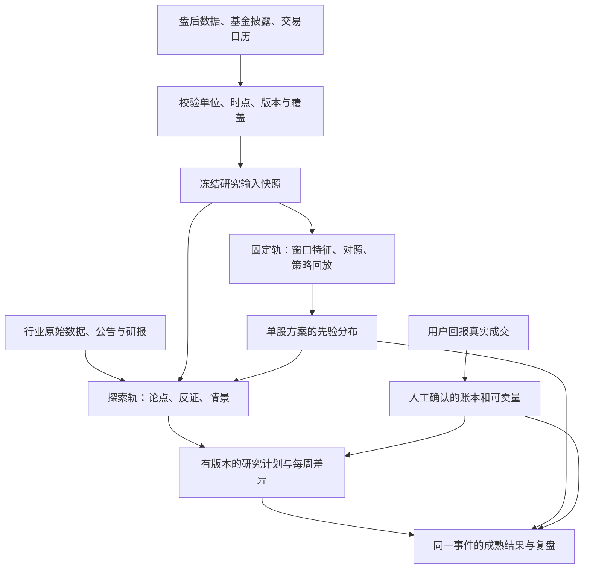

# Roll 生产就绪审查与双轨投研设计

首次评审于 2026-11-25，2026-11-26（上海）补核现行研究模块、Investoday 账户样本和深交所原表。代码基线为 `fix/roll-live-and-history` 的 `f5ecbdcf`。本文是供决策的设计评审稿。下列风险等级按错误会影响哪一项日常决定划分，后文的 P0、P1、P2 表示建设次序。

## 1. 审查维度矩阵

| 维度 | 审查问题 | 现有可核验证据 | 风险判断 |
|---|---|---|---|
| 账户事实与对账 | 同一成交能否解释、重试、跨文件核对？ | Decimal 账本、来源文件、草稿、回执、券商快照核对 | 高。无稳定成交标识时，用户可能确认重复入账 |
| 行情、权益与数据质量 | 缺行、停牌、除息、零成交能否区分？ | 原始 OHLC、复权变换、个股真实派息样本、缺口表 | 高。个股共同漏日和部分重复冲突能伪装为成功 |
| 证券覆盖与资金流 | 每项研究所需的序列是否同口径、连续且可取得？ | 四只宽基 ETF、行业 ETF、份额及净值、沪深 300 指数 | 高。个股没有量额字段，多年资金及市场状态不连续 |
| 历史时点与可重放性 | 过去某晚究竟能看到哪一版数值？ | 财报版本、冻结日报、事后重建与真实前向分轨 | 高。主要行情与跟踪池覆盖写，不能据此还原过去实际可见版本 |
| 评分与概率 | 分数代表何事，概率预测谁、多久、什么结果？ | 冻结四维权重、65% 门槛、沪深 300 二十日同档频率 | 高。覆盖组合改变档位，同档小样本或零样本不足以支持个股交易 |
| 撮合与收益核算 | 当时能否成交？扣费、分红、持仓路径是否一致？ | 次日开盘、整手、最低佣金、原始价、两条独立净值 | 高。全天高低价参与开盘成交判断，现金分红未计 |
| 实验与前向验证 | 探索、选参、检验、上线后预测是否相互独立？ | 两个历史区间、成熟标签、冻结前向样本、Brier 分母 | 高。已留存真实回放两段有效档位均为零，自动择优会放大误差 |
| 归因、计划与复盘 | 本周改变哪条假设？改变后如何验证？ | 财报灯、行业相对强弱、风险卡、冻结日报 | 功能缺口。缺少带证据和版本的单股论点、计划、跟踪与到期结果 |
| 用户界面与时间一致性 | 一屏能否看出今天要核对什么、数据截至何时？ | 三页按需加载，最新工作台与冻结快照可同时核对 | 高。过期价格仍可给出参考股数，历史估值可与最新现金并列 |
| 部署、恢复与运行可见性 | 断网、休眠、升级、磁盘故障后能否说明丢失范围？ | 回环服务、依赖锁、SQLite WAL/FULL、独立数据目录 | 高。任务退出码、业务成功、完整备份、可验证恢复尚未接通 |

这里的“高”指可能改变账户事实、行动参考或研究结论。“功能缺口”指新目标所需的能力。它与旧版是否按约交付分别判定。

矩阵借用了金融模型风险管理中“用途、开发、独立检验、持续监测、第三方数据”这组问题，并把它们缩小到个人工作台能实测的尺度。对 Roll 最重要的两个检查是能否用当时的材料重放一次研究，以及上线后的胜率在所有登记机会中是否仍然成立。银行监管文件仅作方法参照。[监管机构的模型风险管理指引](https://www.federalreserve.gov/frrs/guidance/supervisory-guidance-on-model-risk-management.htm)

## 2. 当前可以依赖到哪一步

**Roll 可以承载人工核对后的盘后研究和账户记录。现有证据尚不足以让它给出可信的单股策略胜率，或让无人值守同步直接服务于仓位调整。** 保留模块化单体、SQLite、三个工作台入口和首次冻结语义。演进的最小对象是一份能到期核对的单股计划。固定轨回答“按这套方案历史上发生了什么”，探索轨回答“这周出现了哪条足以改变计划的事实”。

- **当前合同。** 早期 PRD V1.3 已随 v0 归档。本文评审基线以 v2.1 修订、代码组织方案、实施规格及运行代码为依据。ADR 0001 的本地模块化单体、0002 的按需使用、0004 的重建研究时点原则仍有价值。ADR 0003 已被取代，术语表里的资金授权、G1–G7 等历史对象不作本轮前置。多标的回测、按周计划和新增数据源是对 v2.1 的显式扩展，需独立版本，原有 510300 对照及同日唯一日报继续可重读。[术语表](../../../GLOSSARY.md) · [ADR](../../adr/) · [v2 原稿](../architecture/roll_v2_refactoring_spec.md) · [v2.1 修订](../architecture/roll_v2_1_refactoring_spec.md) · [代码组织](../architecture/roll_v2_1_code_organization.md) · [实施验收记录](../../../.scratch/roll-v2-1-refactoring/spec.md)
- **工程已交付。** v2.1 的 15 张实施票有结项记录。既有真实验收中，江西铜业跨 2025-07-22 派息窗口的增量库和重建库在 63 个交易日取得一致的复权 OHLC、MA、ATR，并独立核对了当日原始开盘价。另有 Windows 启动、记账、冻结、重读的历史记录。这些是可以继续用的资产。[除权窗口](../../../.scratch/roll-v2-1-refactoring/issues/06-watchlist-adjustments.md) · [Windows 工作台验收](../../../.scratch/roll-v2-1-refactoring/issues/15-windows-workbench.md)
- **本次用当前代码复算。** 以 SQLite Online Backup 从留存的 `evidence/history-replay` 真实行情隔离库制作临时副本，区间为 2020-01-01 至 2026-11-24。定权期 970 日、样本外 700 日，有效档位分别为 **0、0**。样本外只有趋势维有效过 2 天，资金、广度、估值均为 0 天。四档历史 Brier 分母全部为 0，该副本的真实前向登记与成熟数也为 0。同期票据确认 510300 原始行情全段无缺价。由此只能评价回放程序如何处理缺数。这个结论仅适用于该快照。[历史回放记录](../../../.scratch/roll-v2-1-refactoring/issues/12-etf-backtest.md) · [校准记录](../../../.scratch/roll-v2-1-refactoring/issues/13-historical-calibration.md)
- **审查范围与证据层次。** 核对了 README、GLOSSARY、PRD、四份 ADR、三份设计稿、实施与验收记录，以及当前受版本管理的后端、前端、测试、配置和脚本。以下区分当前代码行为、本轮隔离反例、仓库既有真实取样、供应商文档声明和拟议方案。11 月 25 日的回放仅使用隔离数据。11 月 26 日的供应商账户取样单列于 §4；请求只包含公开证券标识和日期，未写入工作台。

### 2.1 已接通的模块与用户入口

| 模块 | 用户能做什么 | 当前计算和持久化边界 |
|---|---|---|
| 本地工作台、配置与存储 | 浏览器打开市场、持仓、验证三页；CLI 可单独运行同步、账户、行情、风险、报告及检验 | FastAPI 与 CLI 调用本地 Python 模块，以选定数据目录的 SQLite 为共享存储。跟踪池在同步时生效。账户确认和日报冻结均有独立的写入口。[网页路由](../../../backend/src/roll/web.py#L61) · [CLI 命令](../../../backend/src/roll/cli.py#L43) · [三页导航](../../../frontend/src/main.tsx) |
| 账户镜像、成交与核对 | 持仓页或 `account` 命令读余额、导入 CSV、预览草稿、确认并按回执核对 | 账本记录用户确认的事实，按获知和生效时间重放；成交、费用、权益和更正改变重放结果。实际成交来自记账或导入。回测成交另存在模拟组合中。[草稿与确认](../../../backend/src/roll/accounts/ledger.py#L251) · [历史重放](../../../backend/src/roll/accounts/ledger.py#L483) · [CSV](../../../backend/src/roll/accounts/csv_import.py#L184) · [对账](../../../backend/src/roll/accounts/reconcile.py#L52) |
| 跟踪股和基准日线 | 市场页同步，或用 `sync`、`prices` 查看日期区间 | Fuyao 获取跟踪股及沪深 300 日线。表内保存原始 OHLC、权益变换系数及缺口，读取时按锚点复权；MA20/60 是简单收盘均线，ATR14 以当日高低差、高价与昨收差的绝对值、低价与昨收差的绝对值三者的最大值作为真实波幅，前 14 项均值初始化，以后按 (13×前值＋当日波幅)/14 更新。日线表无逐日成交量、成交额字段。[表结构](../../../backend/src/roll/market/daily.py#L24) · [指标](../../../backend/src/roll/market/daily.py#L294) |
| ETF 与市场输入 | `sync`、`inputs`，市场页查看覆盖与缺项 | AKShare 路径抓交易日历、ETF 行情、份额、单位净值、融资融券余额、市场广度、成交额、估值，按序列／标的／交易日保存。ETF 估算净流量取相邻交易日份额差乘当日单位净值；区间补库每次最多 93 个自然日。[序列与净流量](../../../backend/src/roll/market/inputs.py#L13) · [同步范围](../../../backend/src/roll/market/sync.py#L11) |
| 财报与持仓风险 | `financials`、`risk` 和持仓页按指定交易日观察 | 财报灯检查两组条件：营收同比低于 −10% 且扣非净利同比低于 −20%，或连续两季经营现金流为负且负债率高于 75%。持仓卡计算市值、暴露、超额仓位、行业 ETF 相对基准 20 日收益、5 日估算净流，以及入场后最高收盘减若干倍 ATR 的止损参考；字段显示数据日期与缺项。[财报灯](../../../backend/src/roll/market/financials.py#L126) · [风险卡](../../../backend/src/roll/risk.py#L127) |
| 市场晴雨表、ETF 回测与概率检验 | 市场页查看当日分档，验证页或 `backtest`、`calibration`、`forward` 分别读取策略对照、历史概率和前向成绩 | 一个评分器同时供工作台、冻结和历史重放使用。交易模拟对象固定为 510300.SH，概率标签对象固定为沪深 300；二者使用不同的收益定义。[评分器](../../../backend/src/roll/barometer.py#L164) · [验证入口](../../../backend/src/roll/web.py#L127) |
| 冻结日报与导出 | `report` 或网页首次冻结，之后重读同日报告或导出 Markdown | 在同一写事务中保存账户摘要、行情、晴雨表、风险、概率及前向统计。日期已有报告时直接返回首次内容；该报告能复核当天展示值，原始供应商分页响应和后续更正历史仍需另外保存。[冻结与导出](../../../backend/src/roll/reports.py#L32) |

### 2.2 同一个市场分数如何形成三种结果

现行 v2.1 给定同一批输入与参数，就会算出同一档位。权重、打分节点、仓位上限和执行费用由代码指定；历史样本用来回放仓位规则、统计同档事件频率。当前主流程没有训练单股预测模型、自动选因子或按样本外结果调参的入口。验证页分别回答三个问题：控制 510300 仓位的模拟收益如何，历史同档后指数上涨的频率是多少，真正事先登记的预测后来有多准。[评分实现](../../../backend/src/roll/barometer.py#L12) · [CLI 研究入口](../../../backend/src/roll/cli.py#L117)

1. **收盘后如何分档。** 趋势维占 35，输入为沪深 300 对 MA20/60/120 的偏离、均线排列、波动分位与成交额确认；资金维占 30，输入为四只宽基 ETF 合计净流量 5/20 日滚动和相对 250 日分布的 Z 值，以及两融余额 5/10 日变化；广度维占 20，取上涨家数占涨跌家数之和的 5 日均值；估值维占 15，取 PE(TTM)、PB 的 1260 日分位。各维按预设节点线性插值，有必需特征缺失即整维缺失。可用权重至少 65 才重新归一化计分，25、50、75 分为切点，四档目标上限为 15%、35%、60%、80%。[权重、插值与分档](../../../backend/src/roll/barometer.py#L12) · [窗口和分母](../../../backend/src/roll/barometer.py#L101)
2. **仓位规则怎样回测。** 两个组合各从现金起步。对照首日按开盘价尽量整手买入 510300；策略在首次有效分档或换档后的下一交易日开盘调至上限，其余日期延续库存。按原始收盘估值，当前模拟价格涨跌及交易成本，未计现金分红。默认 10 万元、每手 100 份、佣金万三且最低 5 元、过户费率十万分之一、单边滑点 5 个基点，ETF 卖出印花税设零。2020–2023 定权期与 2024 起样本外各自从现金起算，代码没有在定权期搜索最优权重。输出逐笔成交、净值、年化收益、最大回撤、Calmar、双边成交额／日均净资产，并单列无信号和缺价。[交易模拟](../../../backend/src/roll/backtest.py#L38) · [定权期与样本外分段](../../../backend/src/roll/backtest.py#L178)
3. **同档历史概率怎样得到。** 对每个交易日先结算前 20 个交易日起点的沪深 300 标签，终点原始收盘严格高于起点记 1，持平或下跌记 0。再用截至当天已成熟的同档上涨次数／同档有效次数形成概率，零分母留空。汇总分档报告起点数、成熟数、上涨数、频率、有概率且已成熟的分母，以及这些样本的平均平方误差 Brier。相邻起点的 20 日窗口会重叠。统计模块另有 20／40 日配对分块重采样函数，当前回测、历史概率、前向统计均未调用它。[历史概率与计数](../../../backend/src/roll/calibration.py#L28) · [分块函数与 Brier](../../../backend/src/roll/statistics.py#L11)
4. **真正冻结的预测怎样评分。** 日报首次冻结时，只有冻结日与交易日相同、上海时间至少 15 时、预测日期匹配且档位与概率完整，才尝试登记一条前向预测；回看旧日报不会生成当时的预测。到期后根据两个收盘价写入唯一标签，按登记数、成熟数及 Brier 分母报告成绩。目前允许登记空起点收盘，并在结算时回读后来取得的价格，这会影响前向成绩的证据资格，详见 §3.4。账户盈亏、ETF 择时收益、沪深 300 二元事件各自使用不同的分母。下一阶段提出的单股多窗口计划、周度假设更新及配对增益尚未接入这条链。[登记条件](../../../backend/src/roll/calibration.py#L109) · [结算与读数](../../../backend/src/roll/calibration.py#L121)

## 3. 逐维诊断

### 3.1 账户事实、导入与风险展示

**保留。** 账本通过确认草稿、预期账户版本、幂等键及事务将事件、版本与回执一起持久化。重放分别接受事件发生与系统获知的截止时点。CLI 的 `account reconcile RECEIPT_ID` 核对当时的回执投影。和券商独立快照比较则另有 `RECONCILIATION` 逻辑。今天直接支持的是 Roll CSV 模板，通用券商原生文件仍需字段映射。[ledger.py](../../../backend/src/roll/accounts/ledger.py#L294) · [reconcile.py](../../../backend/src/roll/accounts/reconcile.py#L52) · [cli.py](../../../backend/src/roll/cli.py#L25)

**高风险。** 没有可靠分笔 ID 时，导入器以文件指纹加行号构造身份，并给出警告。持仓页展示 `issues`，漏掉了这类 `warnings`。隔离库重复上传仅相差 UTF-8 BOM 的 100 股买入记录，两份都能进入可确认状态。确认后持仓为 200 股，现金从 5,000 元变成 2,990 元，单次成交应余 3,995 元。反过来，真实的同价同量分笔也可能是两笔。应展示跨文件候选、日期、费用和原始行，让用户逐笔确认或跳过，记录理由。错误编码导入后，原件按同一指纹复用旧草稿，现有 `revise` 也应能从网页或 CLI 到达。[csv_import.py](../../../backend/src/roll/accounts/csv_import.py#L118) · [导入警告](../../../backend/src/roll/accounts/csv_import.py#L221) · [Holdings.tsx](../../../frontend/src/pages/Holdings.tsx#L356)

**高风险。** 持仓卡标明价格过期，却仍用最后可得价计算资产、超额和参考股数。隔离例中，8 月 1 日估值使用 7 月 24 日价格及 7 月 10 日账户事实，仍返回参考减仓 900 股。页面历史日视图还会并列选日风险与最新账户现金。将“最后已知估值”和“可据此计算的参考数量”拆开。保留上次估值、单票暴露与各自日期。任何影响组合分母的持仓价格过期、账户未核对或可卖量未知时，标出受影响的组合和票，相关行动数量留空。账户久未发生变化时，允许用一次截至该日的主动核对恢复新鲜度。[risk.py](../../../backend/src/roll/risk.py#L139) · [参考股数](../../../backend/src/roll/risk.py#L192) · [持仓页](../../../frontend/src/pages/Holdings.tsx#L386)

### 3.2 行情、复权与源故障

**当前分工。** 跟踪股原始／前复权 OHLC、公司行动及沪深 300 原始点位来自扶摇。AKShare 承担 ETF 行情、份额、单位净值、沪深 A 股成交额、两融、广度、估值及部分财报。日线不是全经 AKShare。个股表只保存原始 OHLC，ETF bars 适配器也只保留 OHLC，当前无法直接分析个股量价背离或网格成交容量。保留原价和公司行动的乘数／偏移、指定复权锚点及原价成交。补成交量（股／份）、成交额（元）、交易状态、权益生效与支付日，区分用于特征的复权收益、模拟组合权益及真实账本到账。[daily.py](../../../backend/src/roll/market/daily.py#L24) · [字段与来源](../../../backend/src/roll/market/akshare_inputs.py#L70) · [实际接入成本与依赖](../../../backend/pyproject.toml)

**高风险，两个可重复的漏检。** 在内存库给股票 raw／forward 均返回 7 月 21、23 日，夹在中间的 22 日为交易日。两套返回日期吻合，个股同步却无错误、无缺口，指标按实际行数滚动。另一例在一个市场输入日期送入两个冲突值 10 和 999，首值 10 落库，该日没有失败标记。指数路径已有逐日查缺，AKShare 也已有字段、单位校验及“预算耗尽未发送”标识。把验收单位收紧至“预期交易日 × 标的 × 序列”，分别记录停牌、未上市、源未发布、限流、未请求、冲突和有效零值。冲突日保留上次可信版本，阻断该日新增派生值。未知缺日不得压缩成连续 20 日。[日线窗口](../../../backend/src/roll/market/daily.py#L170) · [输入入库](../../../backend/src/roll/market/inputs.py#L105) · [AKShare 超时预算](../../../backend/src/roll/market/akshare_timeout.py)

**历史与日常需要不同预算。** 空库股票／指数日线默认约 180 个自然日，辅助输入默认 5 个自然日、日常回拉上限约 30 日。显式历史补库按最多 93 个自然日分片，默认取指数和所选宽基输入，广度接口只有当日快照，估值需显式选择。券种、站点和日期的最后成功与失败值得保留。对超时／429 用有上限的退避、抖动和断点续取，对业务拒绝、权限、字段变更区别处理。充分预热后仍无数据的维度继续显示缺口。到下一年度应验证扩展日历的所有调用点，旧回测协议还显式止于 2026-12-31。[同步范围](../../../backend/src/roll/market/sync.py#L14) · [日历扩展](../../../backend/src/roll/market/calendar.py#L52) · [回测时间窗](../../../backend/src/roll/backtest.py#L185)

### 3.3 资金流、基准与数据时点

**系统已有一条可复算的资金流。** 宽基名单为 510300、510500、159915、588000，跟踪池还关联行业 ETF。510300 的既有真实样本中，2025-07-22 较上一交易日减少 98,100,000 份，当日单位净值 4.1929 元，乘积是 **−411,323,490 元**。这个量是按净值折算的一级市场份额净变化估计，含实物申赎的价值含义。ETF 二级市场的大单净买额有独立定义，二者都不能直接分摊为流入某一成分股的资金。遇份额拆分、合并、基金转型或净值迟发需校正或抑制，单位换算只做一次。对比不同 ETF 时，加上一交易日规模归一化的流量率。[真实份额和净值](../../../.scratch/roll-v2-1-refactoring/issues/08-market-inputs.md) · [份额采集](../../../backend/src/roll/market/akshare_inputs.py#L82) · [行业五日流](../../../backend/src/roll/risk.py#L108)

**历史长度由最短的必需输入决定。** 现有资金子项最长需 270 个连续交易日的份额，估值需 1,260 个连续观察，广度需 5 个交易日。既有六年请求仅取到 83 个估值观察和 1 个广度观察。建议按用途输出预期日数、有效日数、最长连续段、最长缺口、最早可计算日和截至决策时已到达的比例。先验基线可单独使用已合格的个股量价序列，扩展特征的增量在相同样本上比较。降低老晴雨表覆盖线会改变它回答的问题。[参数表](../architecture/roll_v2_1_refactoring_spec.md) · [滚动实现](../../../backend/src/roll/barometer.py#L112)

**高风险，日期不等于当时可知。** `daily_bars`、复权变换和 `market_inputs` 按业务键覆盖。跟踪池只有当前生效内容。财报相对完善，保存公告日、观察日、修订哈希，并对部分无法核实的更正返回未知。但当 notice 与 update 一致时，较晚首次取得的数值可以按旧公告日进入重算。本轮合成例中，2026-11-25 首获的季报在 2025-04-25 的重算已亮红灯。对今天解释历史可以这样做，对声称当晚实际看到的信号必须选择当时可消费版本。来源时间只有日精度的，按协议保守推迟消费或记为重建假设。[财报入库](../../../backend/src/roll/market/financials.py#L44) · [财报回放](../../../backend/src/roll/market/financials.py#L126) · [配置覆盖写](../../../backend/src/roll/market/daily.py#L249) · [ADR 0004](../../adr/0004-reconstructed-price-volume-research.md)

### 3.4 晴雨表与概率

**评分适合作为市场背景。** 四维 35/30/20/15、维内必需输入、预热与插值都有明确实现。建议保留当前版本。一个敏感性反例是趋势、资金、广度、估值分别打 100、100、0、15 分。齐全时总分 67.25，均衡档上限 60%。删去后两维，覆盖仍为 65%，归一化后变成 100 分，进攻档上限 80%。上限的变化完全来自证据缺失。发布时须显示本期有效维度组合及档位变化原因，以完整维度和典型缺失组合分别复核历史表现，不能据“档位提高”直接放宽真实仓位。[评分映射](../../../backend/src/roll/barometer.py#L67) · [冻结参数](../architecture/roll_v2_1_refactoring_spec.md)

**当前概率事件是沪深 300 收盘到第 20 个后续交易日收盘是否上涨。** 代码先成熟旧标签，再按同档历史上涨比例估计当日概率。首个样本概率为空，唯一成熟样本为上涨时，下一次同档可报 100%。这个数没有给出单只股票扣费盈利的概率。连续日期的 20 日标签又共享未来收益，样本行数会高估独立信息量。首页明确事件、期限、分子／分母、覆盖组合及区间。验证页加上滚动基础发生率、可靠性分箱、同日配对的 Brier 差和按交易日成块的区间。已有 `paired_block_interval` 可复用，它当前未接入成绩展示，两个端点构成中央 90% 区间。[校准逻辑](../../../backend/src/roll/calibration.py#L28) · [块抽样](../../../backend/src/roll/statistics.py#L11) · [概率评分原理，Gneiting 与 Raftery，2007](https://sites.stat.washington.edu/raftery/Research/PDF/Gneiting2007jasa.pdf)

**前向登记有可靠边界，也有一个需留痕的例外。** 仅上海当日收盘后显式冻结、有档位和概率的日报可以登记。补做昨天不会增加前向数，后续标签也不会改写日报。若预测时指数起点缺价，结算逻辑允许后来补来的起点计算标签。该预测确实事先存在，应分别列出“起点当时已知／后补”的数量和结算版本。新增单股预测带固定事件 ID、当时窗口、数据版本和计划版本。选中才手工冻结的样本应与预登记扫描的全部机会分栏。[冻结事务](../../../backend/src/roll/reports.py#L47) · [真实前向登记与结算](../../../backend/src/roll/calibration.py#L109)

### 3.5 回测、成交与实验可信度

**单 ETF 回放设计清楚。** 两段各自从 10 万元起算，在同一模拟费率下比较晴雨表控仓和买入持有。换档才在次日开盘调整，同档允许漂移，缺信号仍逐日计价。缺必要开盘价后持仓路径未知，缺收盘价则相关净值留空。固定 5 bp 滑点、万三佣金、最低 5 元等是当前比较假设。已有按日期计算股票费税的函数，实际 ETF 回放使用自身固定参数。价格收益尚未计现金分红，会使不同持仓天数的策略产生不同偏差。[回测](../../../backend/src/roll/backtest.py#L130) · [费用函数](../../../backend/src/roll/costs.py) · [README 回测口径](../../../README.md)

**高风险，开盘成交用了开盘后才知道的信息。** 当前逻辑用全天最高／最低是否相等判断开盘触板能否成交。隔离例中，前收 10、开盘与最高都是 11 元，只把当天最低从 11 改成 10.99，结果由跳过买入变成按 **11.006 元**买入，超过全天最高。信号已经延至次日，执行层仍引入了前视。保守起步方案是开盘触及方向限制且无竞价成交依据时记未证实，并记录错失机会。将滑点的经济成本与可成交报价分别建模，处理 tick、上下限、成交容量与无法成交。预登记未成交后的过期／重试规则。[Portfolio.rebalance](../../../backend/src/roll/backtest.py#L46) · [execution_price](../../../backend/src/roll/costs.py#L26)

**扩大策略前先统一交易契约。** 证券类别、板块、规则日期、费用、整手／零股、停复牌、T+1 可卖批次、分红与现金路径归撮合层。趋势、波段、网格只产生意图。网格最容易通过“同日日线碰到两格，假定先买后卖”制造利润。首版采用盘后触发、次日可执行价格单次处理，另报错失成交与库存滞留。若要研究盘中挂网格，在日 OHLC 下给所有可行顺序的保守／乐观界或记不可判。只有顺序改变策略排序才值得采购更细数据。同类 ETF 的回转规则也须按品种核实。[深交所基金交易说明](https://www.szse.cn/www/investor/warning/t20210104_584079.html)

**实验风险高于函数实现风险。** 2024 年后的数据已经有人看过。旧方案继续作为冻结参照，新候选使用时间递增的开发、校准、检验窗与未来影子期。反复使用旧测试窗的结果登记为探索。登记全部窗口、领先期、参数、放弃的策略及失败运行。在相同机会集比较净收益、最大回撤、盈亏比、持仓占用、未成交、成本压力和调整后预测成绩。一次留出胜出不足以认定优势。Qlib v0.9.7 的 Exchange 源码提供价格、量限、价格限制和佣金的独立边界，适合作两三组交易的参照实现。文献支持记录反复试验的选择偏差。本轮阅读了源码与论文，均未作为本地可运行依赖验收。[Qlib Exchange 源码](https://raw.githubusercontent.com/microsoft/qlib/v0.9.7/qlib/backtest/exchange.py) · [Bailey 等，2015 作者稿](https://www.davidhbailey.com/dhbpapers/backtest-prob.pdf)

### 3.6 投研流程与三页工作台

今天可以从行业 ETF 强弱、五日估算流量、ATR 与财报灯一路看到持仓暴露，也能冻结这一天。断点出现在下一周。数据库没有“这条行业观察支持哪条假设、采用哪一版计划、何时证伪、后来如何收场”的持久关联。再写一篇日报无法找回上周决策的分母。给单股增加一个从持仓卡进入的研究档案，让旧日报引用当时存在的计划版本，历史日报按其原始格式读取。[风险卡](../../../backend/src/roll/risk.py#L128) · [日报](../../../backend/src/roll/reports.py#L33) · [三个页面](../../../frontend/src/pages/)

市场页分别调用行情、估值状态与校准。验证页并行读取回测与校准，两次请求之间可以发生同步。每次长区间计算还会重复生成历史特征。建议让一轮运行发布一个可复用的快照 ID，前端只消费这个版本的聚合结果，近期首页用小摘要，长曲线按需读取。简单的 SQL 缓存即可先验证首页打开时间、确认记账延迟及长回放与同步并发时的 P95。[web.py](../../../backend/src/roll/web.py#L65) · [Validation.tsx](../../../frontend/src/pages/Validation.tsx#L149)

### 3.7 本地生产与恢复

Windows 启动已有锁定依赖、回环绑定、Host 与写请求来源检查。SQLite 有 WAL、FULL、外键和初次打开忙锁重试。空参启动每次重新构建前端，日常读历史因此也依赖 Node 构建成功。发布时构建静态资源并记录版本，日常从已安装版本启动。开发入口保留重建。冻结日报的写事务包含历史评分与校准，规模扩大后会占用单写者。先测记账等待时间，再把计算移至一致快照，短事务只完成版本校验和发布。[start.ps1](../../../scripts/start.ps1) · [db.py](../../../backend/src/roll/db.py#L9) · [web.py](../../../backend/src/roll/web.py#L46) · [reports.py](../../../backend/src/roll/reports.py#L47)

同步可返回逐项错误，网页统计失败数，CLI 却仍可能正常退出。合成的上游超时回执经 CLI 后退出语义仍为成功，PowerShell 同步脚本又透传该码。采用统一 `run_id`、`SUCCESS/PARTIAL/FAILED/NO_NEW_SESSION`、必需项失败计数、持续时间、最后成功交易日及日志文件。给每日和每周任务约定互斥键、检查点、SQLite 单写者和恢复后的补跑规则。任务计划用锁定解释器、绝对配置／数据路径、上海交易日判断。PC 休眠回来可追数据，错过的前向预测保持缺席。[roll-sync.ps1](../../../scripts/roll-sync.ps1) · [cli.py](../../../backend/src/roll/cli.py#L36) · [Market.tsx](../../../frontend/src/pages/Market.tsx#L103)

账本已有局部 `user_version=2` 升级逻辑。完整数据库、CSV 原件、研究证据文件与生效配置还缺一个能验证的备份恢复入口。建议每个有变化的运行日做 SQLite 在线一致性备份，以同一清单列出外部文件哈希，完成校验后原子发布。密钥留在本机单独管理。升级前保存备份，顺序编号迁移，先在独立目录还原并检查 `integrity_check`、外键、事件数、回执现金／数量、冻结日报及原件指纹。建议目标为有变化时恢复点不超过一个运行日，恢复耗时在目标 Windows 机实测登记。仅放在同一磁盘的副本只能应对误改与升级，磁盘损坏恢复另需用户控制的第二介质。[账本局部升级](../../../backend/src/roll/accounts/ledger.py#L114) · [SQLite 在线备份](https://www.sqlite.org/backup.html)

## 4. Investoday 应放在哪里

**建议 Roll 后端用 REST 按数据项接入。最先做江西铜业原始量价和一个独立行业行情序列，周研用研报索引。510300 份额与净值可并行对账；159915 的日期口径会翻转资金流方向，暂时排除出该源的资金维计算。** 现有同步入口仍由扶摇与 AKShare 提供数据，本次实测是对新源的独立查询。MCP 适合研究人员临时追问，固定轨需要可重复的请求参数、分页、限额和版本，周度增量研报也可走 REST。[官方接入方式](https://std.investoday.net/apidocs/quick-start) · [当前同步入口](../../../backend/src/roll/market/sync.py#L11)

### 4.1 已用账户验证的数据项

2026-11-26 00:07–00:10（上海），用本机密钥向官方 `https://data-api.investoday.net/data` 发出 7 次只读 POST，涉及 5 个端点。7 次均返回 HTTP 200、业务码 0、有数据。先前匿名请求业务码 40008 可作为“HTTP 成功但业务失败”的对照。表中日期为查询的历史区间，账户验证时间晚于这些日期。公开新版计价下，6 个 L1 页加 1 个 L4 研报页预计占用 16 次权益，未查询实际扣费、账户余额或全文使用许可。[接口目录](https://std.investoday.net/apidocs/api-overview) · [定价规则](https://std.investoday.net/apidocs/pricing)

| 数据项及请求 | 实际返回及对照 | 对 Roll 的决定 |
|---|---|---|
| 个股未复权行情，`/stock/unadjusted-quotes`，600362，2025-07-21 至 23 | 3 天各 1 行。除息日 07-22 开盘 23.73 元，与原扶摇验收相符。量 52,219,668，额 1,241,541,269，两者相除约 23.7754，与返回均价相符。前一日收盘 24.40，除息日接口昨收 23.70，差额与每股派息 0.70 相符。 | 优先验证为个股量价扩展源。分别存原始收盘、除息参考昨收和权益，按交易日对齐后再计算量价特征。三天样本只核对了一个事件，价量内部自洽也不能代替更长区间的外部核对。[原价验收](../../../.scratch/roll-v2-1-refactoring/issues/06-watchlist-adjustments.md) · [未复权日行情](https://std.investoday.net/apidocs/api-reference/股票未复权日行情/股票未复权日行情) |
| 行业行情，`/industry/quote`，机械设备 640000，2025-07-01 至 28 | 每页 10 行，共 2 页，合计 20 个交易日，无重复或缺日。按日期倒序，第 1 页末日 07-15，第 2 页首日 07-14。字段含行业代码、OHLC、量、人民币成交额。文档允许起日从 2020-01-01 开始，每页最多 500 行。 | 可用于独立的行业对照研究。先核对分类版本、目标股票的历史行业归属和单位，再算相对强弱。此次用机械设备检验接口；江西铜业的行业映射另验，跟踪池配置的行业 ETF 保留交易价格与自身身份。[行业字段与分页](https://std.investoday.net/apidocs/api-reference/行业历史日行情/行业历史日行情) |
| 510300 单位净值，`/fund/nav/history`，2025-07-21 至 22 | 2 行 `nav` 分别为 4.1585、4.1929，与 Roll 留存净值逐日相同。响应含 `date` 和累计净值 `navAcc`，本次没有单列实际可消费时间。 | 可并行对账及事后重建。用于盘后信号前，核验基金管理人的实际发布日期／时间和折算窗口。[Roll 净值对照](../../../.scratch/roll-v2-1-refactoring/issues/08-market-inputs.md) · [历史净值](https://std.investoday.net/apidocs/api-reference/基金历史净值/基金历史净值) |
| 基金份额，`/fund/shares-changes`，510300 的 2025 年三季度；另批查 510300、159915 的 07-21 至 22 | 季度查询 `totalCount=68`，取首页 10 行；同一 09-30 同时返回“日”“截止时点”“第三季度报”，期末份额相差 10 份。两只 ETF 的短窗返回 4 条日频记录（`dataSource=9`），沪深结果见下表。 | 保存记录类型、原始截止日和份额。按基金、交易所及频率验收；单靠筛选“日”仍会出现统计日冲突。[份额变动](https://std.investoday.net/apidocs/api-reference/基金份额变动/基金份额变动) |
| 个股研报，`/report/research`，600362，2025-08-25 至 31 | 返回 1 条，`reportId=2802732`，日期 08-30 14:23:13，字段含标题、机构、作者、内容与分类；本条没有回显股票代码。 | 周研可用查询条件、报告 ID、机构与时间登记线索并去重，保存请求标的与归属依据。周六发布的内容按实际决策截止时间使用。报告观点保留来源归属；全文缓存、导出和历史回填另验。[研报字段](https://std.investoday.net/apidocs/api-reference/研究报告/研究报告) |

### 4.2 两个 ETF 的逐日份额给出不同结论

| 标的／来源 | 2025-07-21（份） | 2025-07-22（份） | 两日之差（份） |
|---|---:|---:|---:|
| 510300，Investoday 日记录与 Roll 留存交易所口径均相同 | 92,404,387,700 | 92,306,287,700 | −98,100,000 |
| 159915，Investoday 日记录 | 38,061,454,936 | 38,081,454,936 | ＋20,000,000 |
| 159915，深交所本次下载原表，与 Roll 留存值一致 | 38,081,454,936 | 38,055,454,936 | −26,000,000 |

510300 可以用此次接口数据完整复算 07-22 的估算净流量：−98,100,000 份 × 4.1929 元/份 = **−411,323,490 元**。对 159915，深交所 07-18 的原数为 38,061,454,936 份，Investoday 两行分别等于深交所上一交易日的值。两天支持“该窗口存在一交易日错位”的判断；是否整段如此、源字段究竟表示申赎生效日还是披露日，需要更长窗口和供应商定义。统一平移全部深市日期会给其他区间引入新的误差。四只 ETF 合计是资金维的必要输入；在冲突被解释前，使用现有已核实来源，缺数时保留缺口。[深交所 ETF 规模原表下载](https://www.szse.cn/api/report/ShowReport?SHOWTYPE=xlsx&CATALOGID=scsj_fund_jjgm&TABKEY=tab1&txtStart=2025-07-18&txtEnd=2025-07-22&jjlb=ETF) · [Roll 份额取数](../../../backend/src/roll/market/akshare_inputs.py#L82) · [资金评分](../../../backend/src/roll/barometer.py#L112)

复核标识：上述沪深两日批查的原响应 SHA-256 为 `f93475a27bb08473bd7e0acdf5487651bc5fa2f90ed349cd03c5dda65797ee45`，深交所三日 XLSX 为 `85e3798951caf240fad462990b2276ee8009454a44a4bedbd08c3f4ad0df228e`。本次仅在内存比较并记录摘要；供应商后续重发可能产生不同指纹。

### 4.3 其余能力与接入前提

| 仅据目录评估的能力 | 对开发步骤的影响 |
|---|---|
| 宽基／基金日行情、场内基金资金流 | 指数点位与可成交 ETF 分开对账，分别核对原价、总收益、分红和停牌。`/fund/flow` 的成交资金分层统计可另建指标，单位万元；现有一级申赎估算仍需逐日份额与单位净值。[目录](https://std.investoday.net/apidocs/api-overview) · [场内基金资金流向](https://std.investoday.net/apidocs/api-reference/场内基金资金流向/场内基金资金流向) |
| 历史广度、沪深 300 估值 | 当前涨跌分布端点适合当日采集。历史广度需验证逐日全市场覆盖、上市与停牌口径；指数 PE/PB 需 1,260 个连续有效交易日。此次样本未证明可以恢复老晴雨表的历史档位。[市场涨跌分布](https://std.investoday.net/apidocs/api-reference/市场涨跌分布/市场涨跌分布) |
| 财报时点版、行业景气、研报检索 | 目录列有时点利润表等接口，可选有更正公告的公司核对更正前后两版在各自日期的可见性。行业景气因子需留方法及成分版本，研报片段供周度定位。回测只消费截止时已可取得的版本。[官方目录](https://std.investoday.net/apidocs/api-overview) · [研报向量搜索](https://std.investoday.net/apidocs/api-reference/研报向量搜索/研报向量搜索) |

**接入顺序。** P0b 先做只读 REST 适配和独立样本存储，按“序列、标的、交易日、来源、版本”保存无密钥请求参数、页码、业务码、原单位、到达时间和指纹。现有市场输入表的业务主键不含来源；直接向同键写入会丢掉对账证据。P1a 用一个股票和它实际所属行业扩大测试，加入停牌、除权、深历史月份，核对连续覆盖与成交口径，才把通过的数据项送入固定轨。P2a 可先按周试用研报元数据，至少跨两次周截点验证增量及去重。预热覆盖、长期时延、财报修订和保存条款均保留独立验收。[输入表](../../../backend/src/roll/market/inputs.py#L30) · [代码与接口衔接笔记](../data/investoday-integration.md) · [供应商变更记录](https://std.investoday.net/apidocs/changelog/2026-04-17)

## 5. 双轨的端到端设计

**共用契约是“在某个截止时刻，对某只股票、某一可执行方案作了什么预测”。** 同一股票的指数方向、个股相对收益、网格账户盈利是三个不同事件。两条轨只有在证券、期限、执行费率、输入截止、结果定义都相同的时候，概率才可以比较。这个约束也让“深研是否值得每周花时间”成为可检验的问题。

固定轨由确定性 Python 函数和本地任务驱动。探索轨首版由结构化模板、来源检索和人工判断驱动。已有 CLI 与 Web 继续调用同一进程内的业务函数。若以后增加 Agent，让它返回带出处的证据候选、相反证据和待解问题，经校验后再引用。所有关键步骤均可离线重读，外部服务不可用时保留上期计划、上次核验日期和本期缺口。

### 5.1 数据如何落盘

下表是目标逻辑对象，允许用 SQLite 表或现有表附加列实现。P0 只建恢复与观测所需部分，P1/P2 随第一条真正消费它的链路增量建设。对象间用显式 ID 关联，研究数据无权写账户事件。

| 所属模块与对象 | 最小键与内容 | 保存与重试语义 |
|---|---|---|
| `market` 的 `instrument_relation` | 证券类型、交易所、上市／终止日、指数与代表 ETF、行业代理、映射生效区间、来源 | 同日可关联多个代理，研究协议指定主基准。保留跟踪池和分类历史，避免以今日名单回填 |
| `market` 的 `observation_revision` | 数据集／证券／观察日／字段组／来源／版本，原值与规范单位、发布精度、首次接收、可消费时刻、质量、原件引用 | 同值重试幂等，变更追加修订，覆盖重建请求可指向新快照。原始较大载荷按内容哈希存本机文件，仅保存许可允许的材料 |
| `market` 的 `run`、`run_item` | 任务键、范围、计划日与实际时间、阶段、序列水位、状态、失败原因、尝试数 | 同日手动和定时共用逻辑。成功分片复用，失败可重试。记录未发出、未返回、空结果和冲突 |
| 研究模块的 `input_snapshot`、`feature_snapshot` | 截止、用途、证券及映射版本、每序列版本／内容清单、窗口版本、特征、缺项和预热状态 | 用清单或清单指纹关联实际可取回的观测。缓存键含快照和计算版本，可删除重算。一个快照发布后不可变 |
| 研究模块的 `experiment_run` | 协议、候选全清单、代码／费率／规则版本、数据快照、时间划分、参数、已尝试次数、成交流水与净值引用 | 原协议重放可比对结果指纹。改变窗口、费用或日期生成新运行，失败亦登记 |
| 研究模块的 `forecast`、`outcome` | 证券、方案事件、源轨道、预测时点及期限、先验／修正、分位数、支持样本、预计与实际成熟日、标签及其版本 | 原预测冻结。日后补充及修订标签采用追加记录，区分预期机会、已登记、可成交、可评分数量。保留旧指数前向表 |
| 深研模块的 `research_case`、`evidence_item` | 单股档案、假设及可证伪阈值、原始出处、报告 ID、发布／接收时间、行业口径、事实／解释、支持或反对关系 | 同报告转载去重。证据可被多个论点引用。修订按版本关联受影响的论点 |
| 深研模块的 `plan_version`、`weekly_review` | 标的、前版、依赖快照与预测、证据、有效期、参数、证伪／退出规则、账户参考版本、周差异及结论 | 每周由“档案＋截至的最后交易日＋输入版本”幂等。证据修订新建后继版本。可选关联真实成交回执，未关联保留未知 |

**旧数据升级。** 已存在的行可记为 `legacy_reconstructed`，保存迁移前指纹和首次可核实的盘点时间。不倒造首次到达、历史配置或原件。旧冻结日报按原 JSON 重读，新的快照清单从功能上线日建立。SQLite 保存权威索引、结果与关系，较大证据按哈希归档，派生特征先用 SQLite 缓存。只有基准测试显示全量扫描或存储成为瓶颈，再把可重建的大表导出 Parquet，避免出现两个权威账本。

### 5.2 固定轨：从收盘数据到一个可评分的先验

1. **界定研究名单。** 第一条链用现有 600362.SH、行业代理 512400.SH 和沪深 300／510300.SH。其余当前跟踪股随后接入。配置提出沪深 300／510300、科创 50／588000、上证 50／510050、中证 500／510500，以及已有创业板指／159915 的指数与 ETF 对照。记录指数用点、ETF 价格用元、基金流按具体产品。跨 ETF 汇总注明涵盖份额，同一指数多个 ETF 不能代表指数全部资金。当时未上市的产品记“不适用”。[当前跟踪池](../../../config/watchlist.yaml) · [上证系列指数](https://www.sse.com.cn/market/sseindex/overview/) · [基金产品对应关系](https://www.sse.com.cn/disclosure/fund/announcement/c/new/2026-02-09/588800_20260209_EAHX.pdf)
2. **冻结日历和窗口。** 5、10、20 日按交易日。1 个月、3 个月、半年采用自然月回看，起始锚点取回推日期当日或此前最近已核实的交易日，保存首末交易日与实际样本数。收益含两个端点，n 个单日收益需 n+1 个可比收盘。历史同时满足最长特征预热、开发／校准／留出段以及最后标签的成熟期。有六年 ETF 价格也可能没有一日可用完整特征。输出各窗复权收益、波动／回撤、原始成交量额及比率、相对基准与行业收益、申赎流量率，以及状态切换的日期。20 日和一个月高度重合，保留展示，统计推断登记为相关候选。
3. **检验关联是否提前。** 先比较当日相关，再算 `corr(x[t-k], r[t+1:t+H])`，k≥0，且 x 必须在 t 的决策截止前发布。用收益或标准化流量替代价格水平，报告共同有效日数、实际延迟、滚动符号稳定性。分别控制宽基、行业和波动，避免把行业 beta 称为个股预测力。举例，若 ETF 流领先个股，竞争解释是资金仅追逐当周已上涨的板块。把流量滞后一日、减去行业／市场收益并在下一时间段检验。优势消失时只留“同步背景”。记录所有尝试，对多特征、多滞后和多窗口采用预注册主假设、探索性多重检验校正及未参与选择的留出检验。
4. **在同一现金路径上比较。** 买入持有与现金作基础参照，原有 510300 控仓保留在原比较内。个股从固定仓位的买入持有、趋势、波段和极简网格各一套开始。协议登记信号、下一次可执行入场、资金与库存、加减仓、不可成交／到期退出、股息、手续费和滑点。各策略同初始资金、日期和规则，用共同日期配对，同时报告各自实际覆盖。输出净年化、最大回撤、盈亏比、收益分位、换手、资本占用、最长套牢与错失成交。网格按整个持仓周期并计期末库存浮亏计分。做相邻参数、费用／滑点加倍及延迟一日测试，比较排名是否翻转。
5. **定义方案事件再算概率。** 建议首个主目标为“t 收盘前已知输入生成，t+1 起按预登记规则成交，在指定 20 个后续交易日窗口结束时按契约退出，单次方案扣费后净收益大于零”。主期限、持有／退出计数起点及无法退出日处置先冻结。另存 `P(成交)`、`P(净利>0｜成交且可评分)`、未成交／未结／无法估值的份额，列清每个分母。输出条件平均盈利除以条件平均亏损绝对值、净收益 P10/P50/P90 与回撤尾部。分母为零或支持不足时，比率留空。把预测分布的分位数与“估计胜率有多不确定”的区间分栏。
6. **做可否证的验证。** 用仅含此前成熟样本的发生率作朴素基线。先滚动拟合训练段、用后一段校准，再冻结测试段。切分处剔除标签结果跨边界的训练样本，必要时加间隔。选参和收缩强度仅在内部滚动窗确定。报告原始胜率、向基线收缩后的先验、有效时间块、同日期配对评分差、可靠性图和压力下期望。胜率高不保证正期望，例如赢面 80%、每次赢 1%、每次亏 6%，费用前期望仍是 −0.4%。预定支持或区间精度达不到，输出“样本不足”，保留观察。固定每日研究截点后另积累真实前向，全过程记录未触发、未登记和选择原因。

**固定轨输出。** 每标的、每次运行生成一条可寻址结果，包含 `snapshot_id / as_of / symbol / strategy_version / event_id / horizon / coverage / P(fill) / p_fixed / payoff_ratio / q10,q50,q90 / sample_counts / experiment_run_id`。先验是相对于本次新增的行业或研报信息而言，数据截止、价格／资金口径、样本外区间始终随值返回。首批只在跟踪池内声称适用性，不用今天选中的三只股票推断全市场可投收益。

**第一轮可实现的策略规格。** 下表是提交实验前可选的起始定义，参数尚未经实证。三者使用同一资金上限、交易规则与机会终点。若仓位上限有变，记录是信号变了，还是账户约束变了。

| 候选 | 盘后信号及下一次执行 | 哪种现象会推翻假设 |
|---|---|---|
| 趋势 | 复权 MA20 上穿 MA60 后发出下一开盘的目标仓位，下穿则退出。数据须覆盖前一日以判断穿越 | 匹配市场暴露后优势消失，或均线邻近参数、延迟一天使净期望翻转 |
| 波段 | 在预定义市场状态内，以距 MA20 的 ATR 倍数确定超跌入场带，回到均线或到期退出。上下阈值与最大持有期先登记 | 扣除小额交易最低佣金后回归幅度不足，或样本收益主要来自一次极端反弹 |
| 网格 | 以计划建立日可见的价格和 ATR 定好中心、上下界、格距、每格数量与库存上限。首版按收盘越格形成下一开放时点的单次目标，跳多格遵从冻结的合并／限量规则，周中不漂移中心 | 震荡段已实现小利被单边下行库存亏损抵消，或最保守的成交顺序下排名逆转 |

每日按同一顺序执行“确定有效交易日 → 封存截至实际决策时点已到达的数据 → 计算可用窗口 → 生成并登记全部研究机会 → 下一可执行时点模拟 → 到期结算”。例如周五 NAV 周一开盘后才收到，周五实时快照和周一开盘模拟均不能消费该值。周一取得后可重建周五研究视图，给它新的版本和用途。

### 5.3 探索轨：一次建档，每周核对一次

**第一次深研。** 从持仓或跟踪卡选择一只股票，选定固定轨的一项方案事件。对每条候选论点填入“影响环节、可观察量、支持来源、相反解释、证伪条件、预期时滞和下次检查”。优先查行业原始发布及公司公告，研报补充解释与分歧。每条证据保存原文位置、发布日期、可得时间、版本、单位和复核者。识别同源转载及几个指标共享的驱动，缺证据时把问题留在下周清单。

**以江西铜业为例，以下是一份研究问题模板。** 若有色 ETF 份额连续增加、个股跑赢沪深 300，可提出“行业资金共振”。竞争解释包括铜价共同暴露、库存计价变化、加工费压缩冶炼利润。下一步用库存和加工费的原发布时间、公司矿产铜／冶炼业务敞口、相对行业 ETF 的剩余收益交叉核对。如果只有铜价和板块同涨，持有“板块共振”的观察。只有公司经营数据也支持原先写明的机制，才更新公司层论点。此例不含该股当前事实或交易参数。

**怎样给出最终概率。** 保存 `p_fixed`，修正针对完全相同的事件。初期若无证据支持数值修正，结论可以是“基线 p 可用，景气支持／矛盾，修正幅度未定”，同时给基准、上行、下行情景及对应失效条件。允许用户登记独立、有理由的主观 `p_research`，明确标注并冻结。若连基线也缺样本，两值都可为空。积累足量已成熟配对后，可用预先登记的低维校准模型，如 `logit(p_final) = a + b·logit(p_fixed_bounded) + γ·evidence_score`。收缩、边界处理、证据评分和输入发布时间都在开发窗冻结，避免同一 ETF 表现通过行业和研报被计算两次。只有后段配对 Brier 差、可靠性和费用后效益支持修正，才在该适用范围显示校准的最终数值。即使总体无增益，行业材料也可能提高证伪速度，可单独评估。[概率研究的定位与边界](../architecture/roll_v3_trading_pipeline_spec.md#8-概率研究的定位与边界)

**交易计划落盘。** 一版计划包含证券、唯一方案事件、引用的先验／修正和数据截止、建仓条件和原始价格区间、网格上下界／步长／层数／单格数量、资金预留与最坏库存、单票和总仓位约束、已知可卖量、有效期、止损或证伪观察、跳空／停牌无法退出时的处理、下次核验日、上一版 ID。参数由已验证的方案或用户记录产生。有效预算取账户可用现金、该票剩余额度与组合风险余量的共同可行区间。未知则保留研究意图、停发数量。研究结论可以触发计划失效，真实卖出仍来自用户确认的成交凭据。通过可选的计划版本—回执关联记录部分成交、偏离原因和没执行的机会，保留未归属成交。[实际成交记录](../../../backend/src/roll/accounts/fills.py#L140)

| 周度刷新情形 | 自动做什么 | 用户看到什么 |
|---|---|---|
| 首次建档，或本周材料到齐 | 以上次成功水位加重叠回查取数，用原出处 ID／内容指纹去重。冻结本周最后交易日快照。逐条比对阈值、催化、风险和原假设 | 旧值 → 新值、来源和变化原因。报告日期与实际刷新时间分列 |
| 核心假设成立，参数处于原容许带 | 记录 `维持`，引用原计划版本，仅追加本周核验记录 | 一行结论、下次检查点、可展开的已核证据 |
| 假设成立，波动、容量或风险预算越过预定调整带 | 计算允许的新网格／仓位范围，生成带前版的参数差异和待确认计划。保持此前预测及成绩 | `微调`，列明哪一个参数改变及其对最大库存和占用的影响 |
| 已登记证伪阈值触发，或核心催化已撤销且来源可核 | 标记 `失效退出`、终止旧计划的新增暴露，提示账户持仓与可卖约束 | 证伪证据、失效时点、待人工核对的退出条件。持仓事实独立显示 |
| 行业数据迟发、研报来源冲突、睡眠错过刷新或计划已经过期 | 记 `待核／逾期` 和缺项，保留旧版及最后核验日。补跑注明实际获知日，不回填前向。迟到证据产生后继审阅 | 本周为何无法得出三种有效决定之一，以及需要核对的具体事实 |

周任务建议在本周最后交易日相关资料发布后运行，自动化沿用同一个本地 CLI。休市周记下次有效检查点，重复启动不增加样本，连续数周缺席先展示缺席区间。每日固定轨仍检查事先登记的硬失效条件，遇重大公告或持仓约束变化可提前使计划待核，无须等到周末。周刷新不自动重训或反复重选策略。到期同时保留原计划、影子结果、实际成交和复盘差异，将“数据错、假设错、执行偏离、正常随机亏损”分别记录。

### 5.4 三页如何承载

| 入口 | 日常首先看到 | 深入与写入 |
|---|---|---|
| **Market 今日晴雨表** | 最近收盘日、可用性／缺项、覆盖变化原因、今日待核事项。指数频率写明“沪深 300 未来 20 日上涨，成熟 n” | 展开查看各维、源健康和同步回执，保留“最新／冻结”显示及显式冻日报。作业重试只补失败项 |
| **Holdings 持仓与跟踪池** | 选日账本与价格的共同口径、过期影响、各票当前计划状态、本周需核对的变化 | 从原卡进入单股详情，可深链并返回原名单、选日和滚动位置。详情含“多周期与先验／论点证据／计划与周刷新／实际回执”。手工记账、CSV 与账本核对入口保持可达 |
| **Validation 回测与校准** | 原 510300 回放，新“方案对照”按证券、协议、区间进入，展示基准、净期望／回撤、覆盖与不可成交 | 同一快照比较趋势、波段、网格、买入持有。历史重建、真实前向、先验与深研修正分栏。可从计划回到其引用的那次实验。证据不足给原因与分母 |

接口按用例增加即可，例如读取 `GET /api/research/{symbol}?as_of=…` 返回同一个快照的摘要，`POST /api/research/{symbol}/weekly-review` 按幂等键生成审阅，`GET /api/experiments/{run_id}` 读取已落盘的对照。CLI 调用同一服务。页面状态写入 URL 的标的、交易日与方案版本，切换不会把旧报告显示为新判断。确认周计划与确认账户记账是两个独立操作。

## 6. 分阶段路线图与验收

**研究开发的优先顺序。** 要先回答“现有晴雨表能否改善 510300 控仓”，以 §2 的有效档位天数为基线，先补足能共同满足 65% 的维度。例如趋势和资金正好合计 65%，单补行业行情、个股量额或研报都不会提高现行评分覆盖。先核对资金维四只 ETF 及两融、趋势维指数及成交额的共同预热区间，再数有效信号和真实可核的模拟成交。要回答“江西铜业自身一套策略能否扣费盈利”，可并行验证其原始量价，接下来依赖 P0b 的成交与权益修正和 P1a 的单股实验。两个问题各有验收分母。[维度及必需输入](../../../backend/src/roll/barometer.py#L12)

备份和过期数量保护能直接改善今天的工作台。补个股量额、实际可得时间、指数和一条行业对照，才足以回答第一个单股研究问题。铺满全市场、切换数据库或采用多 Agent 对这两个结论没有帮助。下面按依赖排序，同一阶段可并行做互不依赖的数据取样和运维修复。

| 阶段／投入 | 本地可用的交付切片 | 进入下一步的实测条件 |
|---|---|---|
| **P0a 日常盘后可用**。小至中，收益立即可见 | 明确历史／最新口径和过期提示，CSV 跨文件歧义与草稿修订，统一同步回执与状态码。发布版一键启动、任务计划去重／补跑、版本化备份恢复 | 在隔离目录录入并核对一笔有凭据的成交。以同字节和不同 BOM 重传、并发确认、重启、断网读旧日报。一份有缺项的同步返回 PARTIAL 或 FAILED 和具体字段。休眠／重复触发不多写。恢复到新目录后现金、数量、原件哈希和冻结日报一致 |
| **P0b 数据与回测正确性**。中，决定研究能否开始 | 日期覆盖与隔离冲突，保留原观测／配置版本。补量额与交易状态。修正开盘触限、滑点、现金分红与前向起点标签。为旧协议保留旧结果版本 | 核对一个真实除权窗口、一段跨市场 ETF 份额与 NAV、一次停牌或独立确认的漏日。复现共同漏日、同日冲突、补发旧期财报和开盘触限四例。发布晚于 cutoff 的值在旧快照不可见。开盘可成交判断对之后的日低不敏感，成交／费用／期末权益可手算。按序列提交真实覆盖报告和不可回填清单 |
| **P1a 固定轨最小链**。中，优先交给日常使用 | 一只现有股票、一宽基和一行业，六个窗口，一个预登记趋势方案和买入持有。本地生成快照、基线分布、可评分分母及前向登记 | 同一快照离线重跑结果相同。留一缺日或迟发 NAV，受影响窗口明确为空。盘后手动重跑不增样本。至少给出一个**有实际信号、可核成交与扣费**的真实历史窗口，或清楚判为资料不足。后者仍可上线观察，继续积累和修补数据 |
| **P1b 策略与数据增量**。中至较大，依赖 P1a | 增加波段和受限网格、上证 50／科创 50／中证 500 等配对及资金特征，在 §4 短窗实测基础上完成新增序列的全窗口对账。批量扩至其余跟踪标的 | 同一冻结区间比较价量基础版与加资金／行业版，同时报告交集和全期覆盖。账本逐笔守恒、T+1 可卖、网格库存盯市、成本加倍和延迟一天都能复核。样本外或真实前向不足，保留候选状态和失败记录 |
| **P2a 单股深研与周刷新**。小至中，P1 输出可引用后即可做 | 一只股票建档，写出至少一条可证伪的公司假设，生成方案草案与有效期。周任务抓增量、比较前版，人工可确认变更 | 在两个真实周截点间完成一次增量审阅，指回上周证据、计划与本周来源。用受控材料分别覆盖维持、微调、失效退出与证据不足。重复执行、资料迟到、休眠后补跑均保留原版本。日常可直接用于周复盘 |
| **P2b 量化深研增益**。按成熟样本投入 | 固定先验与研究修正同事件配对、结算，报告命中、可靠性、净效益和覆盖上的差异。只有检索成为主要成本时再引入可替换的取证 Agent | 预定检查点报告配对数、有效时间块及 `平均[(p_research−y)²−(p_fixed−y)²]` 与其区间。上界、经济意义、样本支持与风险达到预先设定标准才采用数值修正。未达到继续用基线或只给情景。每项研究能力单独给出可用范围 |

**什么算生产上线。** P0a 通过后，可把人工核对、风险观察、离线日报纳入日常。P1a 通过后，可用单股档案和扫描结果辅助研究。需要依赖某策略调仓时，另核该方案的真实覆盖、独立检验、成熟前向与成交条件。P2a 的周报即使长期只有“维持”或“失效待核”，只要依据可复核，也有使用价值。策略验证失败或无效是可交付的研究结果。

**另一条可选起步路线。** 如果最迫切的问题是“周五花了两小时，下周还能否接着研究”，P0a 后可先交付人工维护的单股周档和证据差异，先验位置显示“待固定轨”。这比等待多年资金流补齐见效快，代价是不能当周量化胜率。若首要问题是“这只股用网格是否比持有划算”，则按 P0b → P1a → P1b 顺序，先取得可成交、可计费的连续轨迹。两条起步路线共用档案和事件定义，最终可以合流。

## 7. 本次验证及第一项实施建议

| 证据类别 | 已核验 | 这项证据支持的结论 |
|---|---|---|
| 11 月 25 日代码、Windows、本地隔离环境 | 完整后端套件 **47 passed**。TypeScript 类型检查通过。前端构建及无头 Chrome 的 **2 项 Playwright E2E 通过**。回环测试转宿主运行，使用独立 SQLite、无扶摇凭据 | 当前受测入口、草稿确认、冻结／重读和缺数页面可运行。E2E 检查“同步完成”的回执并允许来源失败，不能据此证明当日真实完整同步 |
| 当前代码重放既有真实行情副本 | 沪深 300 标签、ETF 控仓回放及前向统计重算。970＋700 个交易日均无有效档位，四档历史 Brier 分母为零 | 这份验收库存有真实行情，也揭示了哪一层的证据不足。没有测量用户正在使用的数据目录 |
| 本轮隔离反例 | 重复 CSV、股票共同漏日、同日输入冲突、财报回填、缺维升档、过期行动数量、开盘触限、冻结起点后补与同步退出语义 | 可直接转为实施后的回归用例。其数值是构造条件下的反例，不能推断线上发生率 |
| 外部取证 | 11 月 25 日匿名取样及方法参考：行业 API 返回需鉴权的业务码，已读供应商字段／FAQ、Qlib 指定版本的 Exchange 源码、概率评分与回测过拟合论文、SQLite 备份接口 | 支持接口选型和审查方法。其余端点权限、实际配额扣除、持续时延、行业模型有效性、备份恢复演练、跨周值守及双轨收益都需在实施阶段实测 |
| 11 月 26 日算法专项复跑 | Windows 宿主测试模式，隔离目录运行晴雨表、ETF 回测、历史校准、前向登记四组测试，**17 passed**。沙箱首次运行停在涉及 TestClient 的校准测试，宿主复跑通过 | 验证现有规则的实现行为；构造输入的成绩不证明策略具有实际收益 |
| 11 月 26 日账户密钥取样与交易所对账 | §4 的 5 个端点、7 个成功请求；深交所原表按基金代码和日期复核 | 个股原价、行业行情、净值和研报可进入指定用途的试用；两市份额必须分别验收。此次样本未进入任何历史评分或策略净值 |

**第一项实施建议**是做一张现有跟踪股的“截至昨晚，我能用哪些数据”表，并同时修复旧价仍给参考数量的问题。以一只股票、其行业 ETF 和沪深 300 为单位，列出每一条输入的最后交易日、当时可得版本、连续有效天数、缺口原因和可支持的用途。从这张表就能决定明天是否可以做量价研究、该补哪个来源，以及哪个概率应该继续留空。
