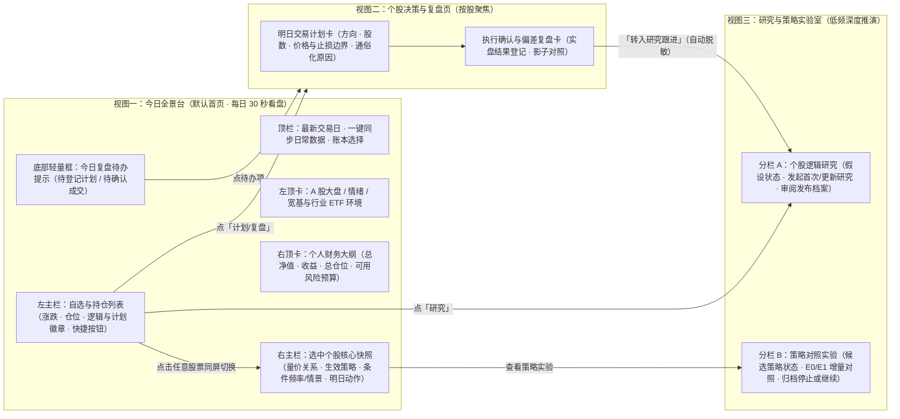

# 05 · 全景看盘主台、自选联动与日常同步

本页保留阶段 05 的交付范围。后续产品命名、页面归属和 ETF 报表以[阶段 06 方案](06-market-workbench.md)为准。

阶段标识为 `roll-workbench-overview`。在 [04 · 工作台模块归位、审阅与复盘跟进](04-workbench-followup.md) 打通研究、实验与复盘闭环后，本阶段从用户每日看盘与决策动线出发，落地低认知负荷的全景主界面与自选池联动体验。

## 1. 设计准则：底层五模块，表层三视图

Roll 的数据与权限底座严格由 `Data Foundation`、`Research`、`Experiment`、`Decision`、`Review` 五模块组成，但用户界面不照搬后台数据库分表，而按 **「先看全局总览 → 再聚焦自选个股 → 按需进入深度动作」**（Overview first, zoom and filter, then details-on-demand）收敛为三个视图：

### 底层模块与表层视图映射表

| 底层核心模块 | 在三视图中的落点 | 界面只展示什么（零冗余） | 明确隐藏什么（留给后台与 CLI） |
| --- | --- | --- | --- |
| **1. Data Foundation** 数据与个人财务底座 | 首页顶栏「同步数据」+ 右顶「个人财务大纲卡」+ 左主栏「自选列表」 | 最新行情日期、同步状态、总资产、持仓收益、总仓位占比、可用资金余量（批次与分红收进按需展开抽屉） | `DataSnapshot` / `AccountSnapshot` 哈希、`observation.seq`、原始流水 JSON |
| **2. Research** 个股研究中心 | 首页右主栏「个股结论徽章」+ 实验室「个股逻辑研究」分栏 | 基本面门禁（通过/未知/未通过）、投资逻辑状态（有效/观察/已证伪）、证伪红线距离、研究任务进度与草稿发布 | 证据 SHA-256、公开输入包路径、长篇原始 Markdown 代码（审阅时仅展示可读标题与正文） |
| **3. Experiment** 策略实验中心 | 首页右主栏「策略与情景摘要」+ 实验室「策略对照实验」分栏 | 策略状态（观察期/已准入）、E0/E1 过滤笔数、净收益与最大回撤对比、差异区段摘要、停止/继续按钮 | `receipt_id`、恒真自检内部字典、`strategy_exposure` 底层暴露表 |
| **4. Decision** 投资决策中心 | 首页自选行「明日动作徽章」+「个股决策与复盘页」上半区 | 唯一生效动作（观察/持有/买入/卖出）、股数、执行价格条件、一句人话解释当前约束 | `P0–P4` 内部英文枚举码、`input_hash`、`plan_revision` 链 |
| **5. Review** 复盘中心 | 首页底部「复盘待办框」+「个股决策与复盘页」下半区 | 待结算/待确认笔数、实盘与模拟结果对比、一键「转入研究跟进」 | `registration_id`、`shadow_book_id`、M0b 20 日工程签收审计表 |

## 2. 视觉风格与空间布局原则（推倒重做，让布局说话）

彻底放弃旧版暖纸墨色研报风格，推倒重做为**极简现代空间布局风格**（清爽中性浅灰画布 `#f5f7fa` + 纯白浮层卡片 `#ffffff` + 细微边框 `#e5e9f0` + 深岩黑主字 `#0f172a` + 静谧蓝主操作 `#2563eb` + 语义红绿涨跌色 + `tabular-nums` 等宽数字），让分组、层级、留白与视觉动线直接传达逻辑，不写冗余的指导文案：

1. **零证据、零审计、零材料来源**：全站任何页面与卡片均不呈现证据列表、材料来源、审计回执、SHA-256 哈希或原始 JSON。
2. **让布局说话**：用空间结构替代文字解释——顶部窄条定全局时点与同步动作，第一行双栏定「大盘环境 vs 个人账户」大纲，第二行左右主从联动「自选股列表 → 当前个股快照」，底部精简提示「复盘待办」；每张卡片最多 **1 个主状态徽章 + 3～4 个核心数字 + 1 个主动作按钮**。
3. **诚实状态、不造假数**：
   - 已接通数据（个股日线及 5/20/60 日量价波动、沪深 300 趋势、申万行业与行业 ETF 相对强弱、个人账户净值与仓位、已发布档案与生效计划）直接点亮；
   - 尚未接入 v3 数据层的指标（全市场广度/两融情绪、宽基 ETF 份额净申赎 E3、跨标的校准概率 M3）以克制的空态占位 `—` 展示，绝不编造实时胜率百分比；
   - K 线图与看图多轮对话在本阶段不引入，留待 M4 会话式个股深研阶段评估。

## 3. 本轮规格要回答的问题

- 自选股票池如何在本地持久化并支持增删排序？点击自选池任一股票时，右侧个股快照如何零跳页切换量价、相对强弱与当前计划摘要，并保留单股「研究」与「计划/复盘」直达入口？
- 首页「同步日常数据」按钮触发哪些已配置的证券与行业序列增量同步？同步期间如何非阻塞反馈成功日期与缺失提示，且不自动触发大模型研究任务？
- 如何将 `P0–P4` 决策裁决码与复盘状态映射为简洁自然的中文结论卡片，同时让需要看账户批次或登记成交的用户在一级抽屉/个股复盘页顺畅完成操作？

## 4. 完成标志

1. 打开工作台默认进入「今日全景台」，一屏内同时呈现 A 股市场/ETF 环境卡、个人财务大纲卡、自选股票涨跌与状态列表、当前选中个股的量价/策略快照卡以及底部复盘待办提示，全页无任何裸露哈希 ID、内部英文错误码或原始 JSON 块。
2. 在自选列表中增删股票并点击切换标的，右侧个股快照即时刷新对应证券的多周期量价、行业/ETF 相对表现及最新生效计划；点击行内「研究」或「计划/复盘」准确进入对应标的的子视图。
3. 从首页触发一次日常行情同步，更新自选池及基准指数最新可得日线后，首页日期水位与涨跌指标随之刷新，且核对后台未产生任何非预期的外部模型调用或草稿变更。
4. 从首页待复盘提示条进入单股决策与复盘页，完成一次执行结果登记与证伪跟进跳转，全流程无需手工输入证券代码、账本名或任何内部版本标识。
