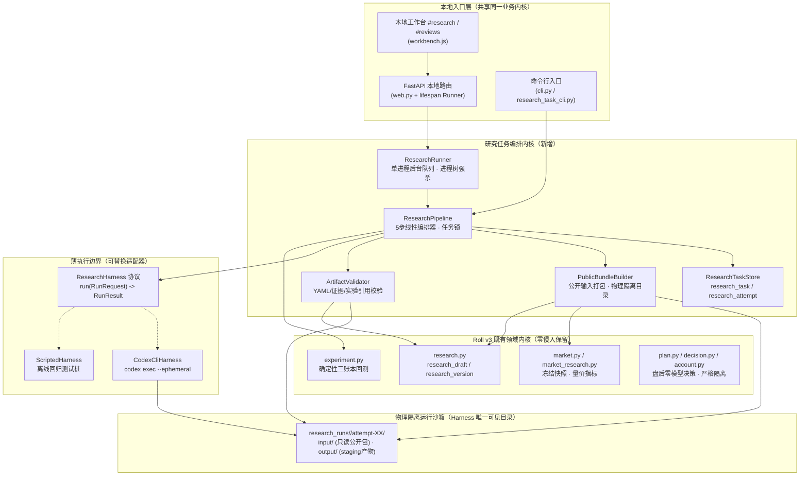
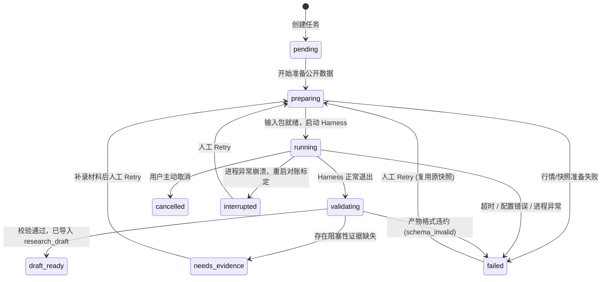

# Roll v3 研究任务编排架构方案

**定位**：本地部署、工作台优先、基于「领域内核 + 薄 Harness 边界」的单次执行研究管线。  
**核心目标**：让 Roll 从被动提供 CLI 命令的工具集，升级为主动发起、编排并管理研究任务的本地研究工作台，打通「提交标的与问题 → 准备公开数据 → 隔离执行研究 → 运行确定性实验 → 校验并生成草稿 → 人工审阅发布」闭环。

---

## 1. 架构原则与安全红线

遵循 Roll v3 既有边界（`docs/adr/0005-external-research-and-deterministic-admission.md`），本方案锁定以下四条不可逾越的硬约束：

1. **状态与成果权威归 Roll**：研究任务状态、快照引用、实验记录、草稿与已发布研究档案全部由 Roll 的 SQLite（`roll-v3.sqlite3`）拥有；Harness 只是无状态研究执行器，不持有任务真相，也不直接发布任何成果。
2. **物理隔离私人账户数据**：Harness 进程的工作目录（`cwd`）锁定在按次生成的公开输入隔离目录中，环境变量与参数绝不传入 `data_dir` 或 `roll-v3.sqlite3` 路径。Harness 无法读取持仓（`AccountSnapshot`）、成交（`TradeLog`）与风险预算（`RiskBudget`）。
3. **研究与决策零耦合**：盘后 `plan` / `decide` 全程零模型调用、断网可重放，不依赖 Harness 在线；未经过人工显式 `publish` 的草稿，绝不进入盘后决策读取范围；Harness 无权修改策略准入状态（`StrategyRegistry`）。
4. **单次执行起步，预留会话迁移边界**：首版采用无状态单次 CLI 执行打通全部业务闭环，同时通过 `ResearchHarness` 接口预留 `session_ref` 与事件回调边界，未来如需升级到长连接会话式后端，仅替换适配器实现，不重写编排内核与表结构。

---

## 2. 总体架构框架图

### 2.1 分层组件图



### 2.2 核心执行时序（从发起研究到人工发布）

```mermaid
sequenceDiagram
    actor User as 研究者（工作台 / CLI）
    participant Web as web.py / ResearchRunner
    participant Pipe as ResearchPipeline
    participant Roll as market / experiment / research
    participant Box as 隔离沙箱 (attempt-XX/)
    participant CLI as CodexCliHarness

    User->>Web: 提交 symbol + 研究问题 (+ snapshot_id / 问题跟进)
    Web->>Roll: 创建 research_task (pending)
    Web-->>User: 立即返回 task_id（不阻塞浏览器）
    Web->>Pipe: 后台线程入队执行

    Pipe->>Roll: freeze_snapshot() + export_market_research() + inputs() + followups()
    Roll-->>Box: 写入 input/ 公开数据包与 preflight_gaps
    Pipe->>CLI: run(RunRequest: cwd=attempt-XX, 只读input, 写output)
    CLI->>Box: 读取公开材料，写入 output/result.json 与 output/draft.md
    CLI-->>Pipe: 返回 RunResult (outcome, exit_code, log_path)

    opt result.json 请求了白名单内的策略实验
        Pipe->>Roll: run_experiment(strategy_version, snapshot_id, research_ref=task_id)
        Roll-->>Pipe: 返回 run_id / report_id
    end

    Pipe->>Box: ArtifactValidator 校验 result.json 与 draft.md
    alt 存在阻塞性证据缺失
        Pipe->>Roll: 更新任务为 needs_evidence（保留缺失清单）
    else 校验通过
        Pipe->>Roll: import_draft() 写入 research_draft，任务置为 draft_ready
    end

    User->>Web: 轮询进度 → 查看草稿、证据链与实验结果
    User->>Roll: 显式点击「确认发布」→ publish(reviewer)
```

---

## 3. 模块划分：保留、调整与新增

### 3.1 原封保留（守住决策与账本边界）

| 模块 | 职责说明 |
| --- | --- |
| `account.py` / `commitments.py` / `entitlements.py` / `execution.py` | 本地真实与影子账户账本、资金预留、权益与撮合规则 |
| `decision.py` / `plan.py` / `strategy.py` / `forward_window.py` | P0–P4 确定性盘后裁决、计划发布与策略准入注册表 |
| `market.py` / `experiment.py` / `experiment_metrics.py` | 不可变行情快照（`data_snapshot`）与三账本回测引擎（已原生支持 `research_ref`） |

### 3.2 最小调整（补齐并发、校验与入口）

| 模块 | 调整内容 |
| --- | --- |
| `backend/src/roll/v3/storage.py` | 在 `database()` 连接初始化时统一开启 `PRAGMA journal_mode=WAL` 与 `PRAGMA busy_timeout=15000`，支撑工作台后台线程与 UI 请求并发读写；严禁在外部子进程运行期间持有 SQLite 写事务 |
| `backend/src/roll/v3/research.py` | 将 `_publication()` 中与发布人/发布时间无关的静态校验逻辑抽离为 `validate_draft_structure(draft)` 供编排器复用；`research_draft` 允许附带可选的 `task_id` / `attempt_id` 关联字段，不改变 `publish()` 的人工确认门槛 |
| `backend/src/roll/v3/market_research.py` | 保持计算口径不变，确保 `export_market_research()` 的 `coverage`（`gap_dates`、`unusable_dates`、`evaluable`）和 `reference`（`market-research:<sha256>`）完整写入任务输入包 |
| `backend/src/roll/v3/cli.py` 与 `web.py` | 注册 `roll research task` 子命令；`web.py` 增加 `/api/research/tasks*` 路由并在 `create_app` 的 `lifespan` 中托管 `ResearchRunner` 启停 |

### 3.3 新增模块（控制在 5 个内聚模块）

| 新增模块 | 核心职责 |
| --- | --- |
| `research_tasks.py` | 在 `roll-v3.sqlite3` 中维护 `research_task` 与 `research_attempt` 表，负责状态流转、快照引用绑定、单任务防重锁及进程重启中断对账 |
| `research_bundle.py` | 冻结或复用 `snapshot_id`，组装纯公开数据输入包与 `preflight_gaps`，构建隔离目录 `research_runs/<task_id>/attempt-XX/` |
| `harness.py` | 定义 `ResearchHarness` 协议与 `RunRequest` / `RunResult` / `HarnessEvent` 数据契约；首版提供 `CodexCliHarness`（`codex exec --ephemeral`）与 `ScriptedHarness`（测试桩） |
| `research_pipeline.py` | 实现 5 步线性编排（`prepare → execute → experiment → validate → stage`）与 `ArtifactValidator` |
| `research_runner.py` & `research_task_cli.py` | `ResearchRunner` 提供本地工作台单进程后台执行（`ThreadPoolExecutor(max_workers=1)` + 进程树终止）；`research_task_cli.py` 提供 CLI 同步执行与管理入口 |

---

## 4. 第一版最小接口契约

| 接口 | 输入 | 输出 | 职责边界 |
| --- | --- | --- | --- |
| `ResearchTaskStore.create(...)` | `symbol`, `question`, `as_of?`, `snapshot_id?`, `benchmark?`, `followup_ids?`, `allowed_strategies?` | `ResearchTask`（`task_id`, `status="pending"`, `snapshot_id?`） | 仅登记任务意图与初始范围，不触发数据冻结与模型调用 |
| `PublicBundleBuilder.prepare(task, attempt_no)` | `task`, `attempt_no`, `data_dir` | `PreparedBundle`（`workdir`, `input_dir`, `output_dir`, `snapshot_id`, `market_research_ref`, `preflight_gaps[]`） | 若未指定 `snapshot_id` 则先调用 `freeze_snapshot()`；导出公开行情、历史已发布证据、复盘跟进与可用策略目录 |
| `ResearchHarness.run(request, on_event=None)` | `RunRequest`（`task_id`, `attempt_id`, `workdir`, `prompt_path`, `output_dir`, `timeout_seconds`, `model?`, `cancel_event`, `session_ref=None`） | `RunResult`（`outcome`, `exit_code`, `log_path`, `result_json_path?`, `draft_md_path?`, `error_code?`, `safe_error?`, `session_ref=None`） | 在隔离 `workdir` 无状态执行一次研究；响应 `cancel_event` 并清理整棵子进程树；不触碰 SQLite |
| `ResearchPipeline.run(task_id)` | `task_id`, `harness`, `experiment_policy` | 更新后的 `ResearchTask` | 持有任务锁，依次驱动数据准备、Harness 执行、白名单实验、产物校验与草稿导入 |
| `ArtifactValidator.validate(bundle, result)` | `PreparedBundle`, `RunResult` | `ValidationOutcome`（`ok`, `status`: `draft_ready`/`needs_evidence`/`schema_invalid`, `evidence_gaps[]`, `experiment_requests[]`, `errors[]`） | 校验 `output/result.json` 与 `output/draft.md` 的格式、时间线与证据引用，通过后方允许写入 `research_draft` |

---

## 5. 五个关键交接机制设计

### 5.1 任务状态机（单一权威在 SQLite）



* **状态流转权**：只有 `ResearchPipeline` 与 `ResearchTaskStore` 能改写状态；Harness 无权读写数据库。
* **崩溃恢复**：工作台或 CLI 启动时检查 `research_attempt`；任何停留在 `preparing` / `running` / `validating` 且无活跃运行锁的记录自动标为 `interrupted`，防止界面假死。

### 5.2 快照引用（不可变且全程透传）

1. **绑定冻结水位**：进入 `preparing` 时，若任务未传入 `snapshot_id`，由 Roll 调用 `market.freeze_snapshot()` 生成并**永久写入 `research_task.snapshot_id`**，同时记录 `market_research_ref`（`market-research:<sha256>`）。
2. **重试同口径复现**：同一任务下的所有 `attempt` 默认**复用同一个 `snapshot_id`**，确保多次尝试基于同一组冻结行情与公告水位；如需刷新最新行情，应新建任务而非覆盖旧任务快照。
3. **实验沙箱外执行**：Harness 若需要验证假设，只能在 `output/result.json` 中填写结构化的 `experiment_requests`（指定允许范围内的 `strategy_version` 或 `robustness` 参数网格），由 `ResearchPipeline` 在沙箱外调用 `experiment.run_experiment(..., snapshot_id=task.snapshot_id, research_ref=task.task_id)` 执行，并将 `run_id` / `report_id` 记入 `research_attempt`。

### 5.3 证据缺失（结构化暴露，绝不编造）

* **预检缺失（Roll 已知）**：`PublicBundleBuilder` 从 `export_market_research()` 的 `coverage`（`gap_dates`、`unusable_dates`、窗口 `insufficient_coverage`）中提取缺口，写入 `input/manifest.json` 的 `preflight_gaps`，明确约束 Harness 不得自行补齐或外推。
* **研究期缺失（Harness 声明）**：`output/result.json` 必须声明 `evidence_gaps[]`（每项包含 `topic`、`missing_item`、`blocking: bool`、`suggested_source`）。
* **阻塞分流**：只要存在 `blocking: true` 的缺口，任务即落入 **`needs_evidence`** 终态（而非 `failed`），把缺失清单直接呈现在工作台，供你通过 `roll market import` 或补充公开材料后再次重试；非阻塞性缺失允许进入 `draft_ready`，并在草稿中保留对应未知项说明。

### 5.4 重试与取消（按 Attempt 物理隔离）

* **目录与记录隔离**：每次执行分配递增 `attempt_no`（`attempt-01`、`attempt-02`…）和独立目录，保留完整 `.log`、`result.json` 与 `draft.md`，绝不覆盖历史尝试记录。
* **重试策略分类**：
  * **允许自动/一键重试**：`timeout`、`process_error`、`interrupted`、`schema_invalid`（下一次 `attempt` 的提示词可自动附带上次的校验错误摘要，受 `max_attempts` 上限约束，建议默认上限 2 次）。
  * **必须人工介入后重试**：`needs_evidence`（等待补录公开证据）、`config_error`（CLI 未安装或未登录）、`cancelled`（用户主动取消）。
* **进程树强杀**：Windows 本地部署下，`CodexCliHarness` 须绑定 Job Object（参考 Focus `WindowsJob` 语义），在超时、用户点取消或 FastAPI `lifespan` 关闭时确保连同子进程树一并终止。

### 5.5 草稿交接与人工发布门禁

1. **Staging 隔离产出**：Harness 仅被允许将草稿写入 `attempt-XX/output/draft.md`，无权直接调用 `roll research draft` 或 `roll research publish`。
2. **入库前强校验**：`ArtifactValidator` 对照 `validate_draft_structure()` 核验：
   * UTF-8 编码与合法 YAML frontmatter；
   * `symbol` 与任务一致、`as_of <= task.as_of`、`evidence` 每条均具备 `id / title / source / locator` 与 `url / document_id`，且 `received_at <= as_of`；
   * `evidence_refs`、`invalidation_triggers`、`constraint_basis` 引用的证据 ID 全部在 `evidence` 中登记；
   * 若正文或元数据引用了实验结果，校验对应 `run_id` 归属当前任务且使用相同的 `snapshot_id`。
3. **导入草稿与人工发布**：校验通过后，由 Roll 调用 `ResearchDossiers.import_draft(symbol, markdown, version=...)` 写入 `research_draft`（`review_status="draft"`）并置任务为 `draft_ready`。最终由你在工作台审阅后显式触发 `publish(reviewer=...)`，发布前盘后 `plan` 完全不可见该草稿。

---

## 6. 分阶段实施切分

1. **Phase 1（无模型闭环与并发底座）**：完成 `storage.py` WAL 改造、`research.py` 校验抽离、新增 `research_tasks.py` / `research_bundle.py` / `harness.py`（先接 `ScriptedHarness`）/ `research_pipeline.py` / `research_runner.py`，用 `600362.SH` 跑通建任务、隔离打包、校验入草稿及不影响盘后 `plan` 的全链路回归测试。
2. **Phase 2（接入真实 Codex CLI）**：实现 `CodexCliHarness`（`codex exec --ephemeral`）、Windows 进程树清理与日志流式落盘，验证超时取消、`needs_evidence` 降级与 `schema_invalid` 报错重试。
3. **Phase 3（工作台交互集成）**：结合 `web.py` 与 `workbench.js`，设计并落地 `#research` 与 `#reviews` 的研究任务发起、进度轮询、缺口重试与草稿一键审阅发布界面。
