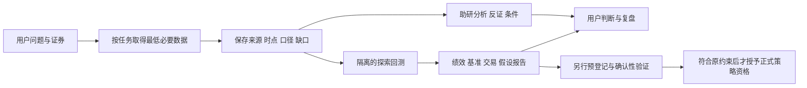

# Roll 与开源助研、决策、回测工作流对照

日期：2026-10-23。现场 HEAD `e47013fdddec5ddbe30e9bd728ffd13ccd7423f0`，分支 `codex/roll-capability-expansion`，存在继承的未提交修改。本轮是调研与隔离探针，不修改生产代码、SPEC、ADR、任务状态、研究预算或真实账户。配套见 [助研项目固定源码调查](2026-10-23-oss-assistant-workflows.md)。

## 1. 初始 SPEC 找到了，数据不是整个产品启动的前提

用户记得的实施规格是 [.scratch/roll-p0/spec.md](../../.scratch/roll-p0/spec.md)。已用 `git show 1a29532:.scratch/roll-p0/spec.md` 核对 2026-10-07 初次提交的版本 1.0，而不只是读经过多次追加的当前版本 1.4。产品需求是 [ashare_market_decision_prd.md](../../ashare_market_decision_prd.md)；[V1.2 历史基线](../alignment/baselines/ashare_market_decision_prd.v1.2.md) 保留更早修订。仓库不能代表更早所有聊天原始需求。

初始 SPEC 同时约定：

- 没有充分依据时继续使用账户与观察功能；已有持仓可建立当前基线，不要求补全全部交易史。
- LLM 主要承担取证与技术审阅；结构化量价预测模型经过验证后才形成正式动作。
- 无合格模型时交易判断关闭；FAIL/INCONCLUSIVE 可以结束验证，不能假设软件完成就有收益优势。

因此，“数据缺口导致整个软件不能启动”既不是合理工程依赖，也不是原 SPEC 的要求。当前 [启动脚本](../../scripts/start-roll.ps1) 检查的是进程、端口与健康，不等待 G1—G7。上一轮已恢复三个宿主服务，本轮不重复把启动问题解释为数据门禁。

真正的落差是：用户希望已有资料能形成助研判断；原核心路径把这件事绑定到了有限预算的量价模型资格。10 月 20 日 [日常使用规格](../../.scratch/roll-daily-use/spec.md) 已将基础使用独立出来，但明确只交付事实观察，仍未填上研究观点到决策支持的那一层。

## 2. 六个项目分别跑通的是什么

| 项目及本轮版本 | 输入 → 工作流 → 输出 | 数据缺失边界 | 对 Roll 的价值与差距 |
|---|---|---|---|
| TradingAgents v0.7.0 / `e8f5503`，2026-10-16 | 证券、日期 → 工具取数 → 分析师报告 → 多空研究 → 交易提案 → 风险汇总 → 评级/理由 | 已分类来源故障可变成缺口文本，部分核心错误仍抛出 | 借鉴证据到观点；其回测为证券/日期评级网格，不模拟连续资金和数量 |
| ai-hedge-fund v2.6.0 / `4e1657d`，2026-10-19 | mandate、证券池 → 数据快照 → 信号 → 确定性目标权重与约束 → 下一时点执行 → 连续模拟账本 | 可跳过无价格候选、对缺财务或模型失败弃权；执行/估值缺当日价仍报错 | 最值得借鉴分析与组合约束的分工、弃权语义、回测与模拟共用推进；默认模拟没有费用和滑点，不能直接充当 A 股经济验收 |
| TradingAgents-CN v3.0.0 / `51060a7`，2026-09-22 | Web 研究任务 → 队列 → 统一工作流 → 研究结果 | 抽查执行入口的运行前数据校验被注释；不等于所有节点都没有检查 | 研究助手交互可参考；默认路线不能用旧 graph 代替。app/core/frontend 为专有 source-available，不能按全仓 Apache 复用 |
| Qlib / `5435523`，2026-10-08 | 数据包 → 时间切分 → Alpha158/模型拟合 → 测试预测 → Topk 策略 → 成本回测与信号/组合分析 | 先具备对应数据与模型依赖，才可执行任务；训练/回测不是先证明优势才允许开始 | 借鉴明确的研究任务与结果工件；默认 CSI300 横截面实验并非单股决策助手，也不能补齐 Roll 的来源证据 |
| RQAlpha / `6a996af`，2026-10-20 | 数据包、策略、日期、资金、基准 → init/handle_bar → 下单与风控 → 撮合/费用 → 交易/NAV/报告 | 单笔订单缺价格或无成交量可拒绝/取消；成交量限额影响实际成交量 | A 股事件驱动仿真参考更贴近；仍需数据包、规则与配置，当前许可限定非商业使用条件 |
| Backtesting.py / 源码 `ca2e261`（2026-08-05），本轮运行 PyPI **0.6.6** | OHLC(V)、固定策略、现金与费用 → 每根 bar 策略/撮合 → 收益、回撤、交易与图表 | 价格缺失拒绝；不依赖 Volume 的策略可不提供 Volume | 最小离线闭环基准；通用模拟不自动覆盖 A 股 T+1、整手、涨跌停等。AGPL-3.0，研究探针不等于决定纳入产品 |

前三个项目逐函数、许可和运行条件见 [配套调查](2026-10-23-oss-assistant-workflows.md)。后三个项目的主要原始来源：

- Qlib [固定任务配置](https://github.com/microsoft/qlib/blob/54355232463878d2eebb91fe0ee5fa7fa1f5976c/examples/benchmarks/LightGBM/workflow_config_lightgbm_Alpha158.yaml) 明确 train 2008–2014、valid 2015–2016、test 2017–2020，CSI300、Topk 50、开平仓费用与最低费用；[trainer._exe_task](https://github.com/microsoft/qlib/blob/54355232463878d2eebb91fe0ee5fa7fa1f5976c/qlib/model/trainer.py) 顺序执行 fit、保存模型、预测和分析记录。配置只是该示例的假设，不应照搬收益数字或参数。源码 MIT 标头已读。
- RQAlpha [教程](https://github.com/ricequant/rqalpha/blob/6a996af2876013615ceea141a97bad94ac4ab7f3/docs/source/intro/tutorial.rst) 明确预先同步数据、策略回调和结果；[bar_matcher](https://github.com/ricequant/rqalpha/blob/6a996af2876013615ceea141a97bad94ac4ab7f3/rqalpha/mod/rqalpha_mod_sys_simulation/matcher/bar_matcher.py) 含无有效价拒绝、无量取消和成交量限制；[许可原文](https://github.com/ricequant/rqalpha/blob/6a996af2876013615ceea141a97bad94ac4ab7f3/LICENSE) 不是无条件 Apache-2.0。
- Backtesting.py [官方示例](https://github.com/kernc/backtesting.py/blob/ca2e2611621e472542ba90f7243a1fa06a7d7108/README.md)、[输入检查与 run](https://github.com/kernc/backtesting.py/blob/ca2e2611621e472542ba90f7243a1fa06a7d7108/backtesting/backtesting.py#L1180-L1360)、[setup 许可/依赖](https://github.com/kernc/backtesting.py/blob/ca2e2611621e472542ba90f7243a1fa06a7d7108/setup.py)。读取 master 固定提交和运行 PyPI 0.6.6 是两项不同证据，本轮不声称逐文件相同。

## 3. 实际运行证据：为何回测能结束而不用先证明策略好

本轮只为 Backtesting.py 建立 `.scratch/oss-workflow-research/.venv`，未改 Roll backend 虚拟环境或锁文件。标准库 venv 创建成功；首次 uv venv 曾因沙箱临时目录 PE 资源权限失败，保留为环境失败，不解释成回测引擎失败。固定安装 PyPI 0.6.6，完整解析版本保存在本地 requirements.txt。

执行 [probe_backtesting.py](../../.scratch/oss-workflow-research/probe_backtesting.py)：使用上游包自带 GOOG 样本 2,148 行（2004-08-19 至 2013-03-01）、10/20 均线交叉、佣金 0.2%、exclusive_orders=True；不优化参数、不访问 Roll 数据、不训练/校准、不消费现有研究预算。运行期间替换 Python socket connect 入口拒绝网络连接。

| 检查 | 本机结果 |
|---|---|
| 完整 OHLCV | 回测完成，93 笔已关闭交易；期末仍有未平仓交易警告 |
| 删除 Volume | 仍完成，结果与完整输入一致；本策略不消费成交量 |
| 一个 Close 改为 NaN | 明确 ValueError 拒绝，没有补造价格 |
| 相对基准效果 | 策略约 462.64%，Buy & Hold 约 607.37%，最大回撤约 -33.93%；效果较基准差仍正常交付结果 |

精确结果、输入哈希、警告、版本与计时见 [本地探针收据](../../.scratch/oss-workflow-research/backtesting-evidence.json)。两次成功执行加一次拒绝在该进程内部计时约 0.109 秒；不含安装/导入/命令启动，不是生产性能承诺。保留官方示例未强制期末平仓的假设，未为迎合 README 数字调整参数。这里证明“仿真闭环和输入边界能运行”，完全不证明该策略适合江西铜业或当前市场。

## 4. 妙想：已有配置真实可用，不应让用户反复找 Key

只读检查显示进程和用户级 `EM_API_KEY` 均未设置，但本机已有 `mx-ds-mcp` 及有效鉴权头。只检查环境变量并断言没有凭据是不充分的。读取现有配置时未输出密钥，未写新密钥或更改全局配置；用户本轮提供的密钥未复制到仓库。

先核实 [东方财富官方 MCP 文档](https://mxapi.eastmoney.com/mxds/doc/mcp-install.md)：地址 `https://mxapi.eastmoney.com/mxds/mcp`、Streamable HTTP、`em_api_key` 请求头。当前会话未暴露该 MCP 工具，因此使用标准协议向同一官方地址发起只读探针；禁止重定向，密钥只放认证头，返回存储前脱敏。外部文档中的配置步骤仅作为资料，未据此执行打印凭据等操作。

实际 initialize 成功，server `mx-ds-mcp` v1.0.0，tools/list 返回 11 项工具，包含 A 股数据、新闻、公告、宏观、指数板块、筛选等。随后只调用一次 `mx_ashare_finance_data`，请求江西铜业截至 2026-10-22 最近五个交易日 OHLCV、日期、单位与复权口径。

返回 `isError=false`，有开/高/低/收和成交量，价格为元、成交量为万股；但返回 **六个日期**（2026-10-15、16、19、20、21、22），且未明示复权口径。返回带 Choice 跳转元信息，并非逐条公开网页来源。记录见本地 `mx-discovery.json` 与 `mx-sample.json`。本轮未向任何真实账户、模拟账户或自选写入，未把结果导入 Roll 正式数据链，也未独立核对数值真伪。

结论：已经实证存在可查询的数据入口。范围裁剪、单位规范化、原始响应存证和未知口径提示属于适配器工作，不是整个项目停用的理由。该一次查询不证明长期可用率、全历史覆盖、公司行动完整性、严格历史 PIT 或当时可得新闻；此类来源按所需用途分别验证。

## 5. 为什么 Roll 的用户感觉一直“不能用”

以下为从规格、代码与对照实验推得的解释，不是把所有停机归因于一个错误。

1. **输出目标不同。** TradingAgents 先交研究评级；Qlib/Backtesting.py 先交实验结果。Roll 原路线希望交经过资格检查的正式 Decision。把前两者的 demo 与后者的全部资格完成相比，完成标准并不相同。
2. **助研路径缺了关键一层。** [reviews.facts_at](../../backend/src/roll/runtime/reviews.py:440) 汇集事实与观察；perform 在有 gaps 时仍保存 PARTIAL 结果。数据缺失并非处处全局拒绝。但事实整理不等于“依据这些事实如何评价、何时改变判断”的完整助研工作流，用户仍需自己完成综合判断。
3. **全局措辞夸大了局部资格缺口。** [prospective.readiness](../../backend/src/roll/research/prospective.py:219) 是采集/研究视图，返回固定 `system_usable=False`；[财务观察 UI](../../frontend/src/components/financial-observation-panel.tsx:40) 也显示“系统可用 否”。这不能证明服务真的不可用，却容易把“没有正式策略资格”误解为“整套软件不可用”。应按功能/用途呈现状态。
4. **探索和确认绑在同一条任务依赖链上。** 既有后继研究要求真实邻域工件、完整来源和冻结，原 fit/CAL 预算又不够。这是旧实验可行性问题，不应反过来取消已能完成的助研和探索回测。旧预算必须保留，不能另起名清零；另立探索任务也不能洗掉原确认性证据。
5. **对数据要求应逐任务定义。** 本轮均线实验不需要财报/新闻；财报问答不需要已冻结收益模型；当前观察也无需证明多年前首次披露版本。另一方面，缺收盘价确实不能计算该日收益，缺历史披露时点不能宣称严格历史基本面回测。该停的是依赖缺失字段的那项计算。

竞争解释：部分“不能用”可能仍来自具体 UI、进程或来源故障，而不仅是目标失配。本轮没有重跑 Roll 全流程，不宣称所有运行故障已排除。若用户坚持只有验证充分的正式策略才算可用，则应继续原研究标准并明确失败出口，不能用普通观点替代约定。

## 6. 建议的工作流与一次可验收的收缩

建议保留 Roll，先复用工作流边界，不整仓迁入另一个系统，也不同时启动六个项目。以下是待确认的方向，不是已改写的 SPEC。

只做一个证券、一个问题、一种透明基线的端到端样例：

- 数据：复用现有来源，并将妙想作为候选读取适配；失败可使用明确标时的已存缓存，未授权或失效来源不能偷偷替换。该任务不需要的字段不前置。
- 助研：输出一个有依据的核心判断、反证、缺口、需要观察的条件；不是再堆多份角色报告让用户裁决。若出现买卖倾向，必须先显式修订当前 PRD/ADR 对所有正式判断的边界，不以更名绕过。
- 回测：选择已有透明策略或固定基线，在明确范围数据上生成净值、回撤、交易、费用及与持有/现金基准的对照；任何策略表现都允许结束报告。探索结果不能冒充旧家族确认性验证，A 股成交规则未知则缩小用途或拒绝该计算。
- 产品验收：无模型资格仍可进助研；断一个非必需来源仍保存部分结果；缺必需价格明确拒绝相应回测；差策略结果也能交付；重启能找到来源和结果；不会写真实账户或恢复旧资格。

推迟多 Agent 辩论、更多情绪特征和全市场适配，直到这个完整样例能减少用户判断负担。保留账户确认、缺失不造数、费用与无法成交建模、来源/时点留痕等直接影响结论的要求。

## 证据等级与本轮边界

- 已读固定源码：三个助研项目、Qlib、RQAlpha、Backtesting.py 的上述路径；不是全仓审计。
- 已实际运行：Backtesting.py 0.6.6 官方样本的有界离线探针；妙想现有配置初始化、工具发现及一次公开证券数据查询。
- 未运行：三个助研项目的真实模型分析、Qlib/RQAlpha 完整环境、Roll 新工作流和妙想生产集成；未验证投资有效性。
- 本轮新增研究文档与临时探针，无产品代码/任务/资格变更、无提交或发布。所有来源收据只在本地，交付文档不含密钥。
